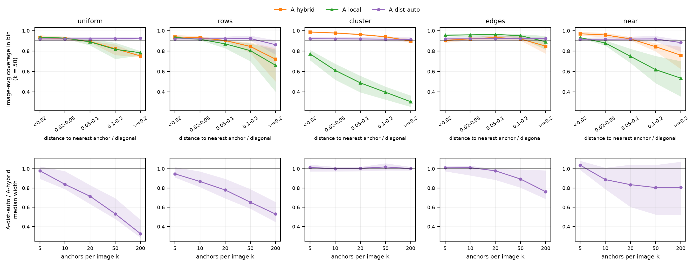

# SpaCal-Depth

Post-hoc conformal calibration of **frozen** monocular metric depth models (Depth Anything V2 Metric, UniDepthV2, Depth Pro): per-pixel depth intervals with distribution-free coverage guarantees, evaluated on NYU Depth v2, KITTI and DIODE. The exchangeable unit is the **image or scene**, not the pixel.

The full write-up, with every number, the theory behind each guarantee and the limitations, is [`docs/PROJECT_REPORT.md`](docs/PROJECT_REPORT.md). The design of the distance-aware anchor method is in [`docs/ANCHOR_METHOD_PROPOSAL.md`](docs/ANCHOR_METHOD_PROPOSAL.md); the original plan and theory primer in `SpaCal-Depth Research Plan, Theory Primer and Build Guide.md`.

## Main results

- **The image (or scene) is the unit.** Run-to-run variability of coverage follows the number of calibration images, two orders of magnitude above a pixel-count prediction. Scene-level calibrators fix the small shortfall of image-level ones at a 3–12 % width cost.
- **Coverage is even on average, not per image.** Per-image coverage ranges from about 40 % to 100 %; one global scale error per image explains 65–79 % of that variation.
- **A few true depths per image ("anchors") help most.** Intervals become 1.3–3.7× narrower at the same 90 % average coverage, and A-both (the hull of a cross-image and a within-image method) cuts badly covered images from 9–18 % to 0–0.2 %.
- **Structured anchors break the within-image guarantee.** With clustered anchors A-local covers 26–47 % while its intervals shrink; the cross-image guarantees survive.
- **Distance-aware anchors (A-dist).** Calibrating separately by distance to the nearest anchor keeps coverage within 0.5–1.4 points across distance (5–15 without it), and with 20 or more anchors is 17–67 % narrower than A-hybrid with random, scan-line or near-only anchors.
- **Safety queries.** A guarantee protects only the quantity it was calibrated on: calibrating the nearest depth in a region directly is both valid and informative; per-pixel guarantees are not.



## Repository layout

```
src/
  config.py          paths and device via SPACAL_* environment variables
  data/              NYU, KITTI, DIODE loaders, eval protocol, PixelTable storage, scene splits
  models/            DA-V2, UniDepthV2 and Depth Pro wrappers (GPU only)
  scores/            scale maps S0–S4c, learned S5/S6, groups, raw baselines
  calibrators/       exact CRC, K1/K1-scene, RCPS, split CP, Mondrian, registry,
                     anchors.py (A-rescale, A-hybrid, A-local, A-both, layouts), anchor_dist.py (A-dist)
  metrics/           depth metrics, interval metrics, safety queries
experiments/         prepare_tables, e0–e12, run_calibration, summarize, make_figures, qualitative
scripts/             data download, prediction caching, run_all_gpu.sh, run_all_cpu.sh, run_e11.sh, run_new.sh
slurm/               sbatch files for a Slurm cluster
colab/               notebooks for GPU caching on Colab
tests/               62 tests, incl. Monte-Carlo checks of each guarantee
results/figures*/    all figures in the report
```

Raw result CSVs, prediction caches and prepared tables are not in the repository (several GB); they are regenerated by the pipeline below.

## Install

Python 3.12.

```bash
python -m venv .venv && source .venv/bin/activate
pip install -r requirements-dev.txt     # CPU only: every calibration experiment, tests, figures
```

Model inference (caching predictions) needs a GPU and the full stack: `bash scripts/setup_remote.sh` installs torch (CUDA 12.8 wheels), `requirements.txt` and UniDepth. Depth Pro needs `transformers >= 4.49`. On Colab, use the notebooks in `colab/` with `requirements-colab.txt`.

## Pipeline

```
GPU  ── scripts/cache_predictions.py ──►  cache/<dataset>/{gt,<model>}/<sample>.npz   (once)
CPU  ── experiments/prepare_tables.py ──►  prepared/<dataset>__<model>.npz           (valid pixels on a lattice)
CPU  ── experiments/run_calibration.py, e*.py ──► results/<exp>/*.csv ──► summarize.py, make_figures.py
```

Everything after caching is numpy / scipy / scikit-learn and runs on any CPU. Paths and device come from `SPACAL_DATA_ROOT`, `SPACAL_CACHE_ROOT`, `SPACAL_PREPARED_ROOT`, `SPACAL_RESULTS_ROOT`, `SPACAL_DEVICE` and `SPACAL_SEED` (`src/config.py`).

## Reproducing the results

```bash
bash scripts/download_data.sh                 # NYU labelled + splits, KITTI Eigen test, DIODE val (~8 GB)
GPUS="0" bash scripts/smoke_remote.sh         # 3 images per pair, E0 table, tests
GPUS="0 1 2 3" bash scripts/run_all_gpu.sh    # cache predictions, one dataset per GPU (resumable)
bash scripts/run_all_cpu.sh                   # tables, main study, E0, E1, E5, E8, summaries, figures
bash scripts/run_e11.sh                       # anchors (E11)
bash scripts/run_new.sh                       # E12, E13, E14 and the Depth Pro pairs
python -m experiments.make_figures
```

On a Slurm cluster the same steps are in `slurm/` (`smoke`, `cache`, `cpu`, `e11`, `new`); `slurm/env.sh` holds the shared job environment. Pass partition and GPU type on the command line, e.g. `sbatch -p <partition> --gres=gpu:<type>:1 slurm/cache.sbatch`. The full CPU pipeline takes roughly 8–10 hours on 32 cores; every result directory gets a `spec.json` with its exact settings.

## Methods

Scores (`src/scores/`): S0 constant, S1 relative, S2 log, S3 flip, S3e ensemble, S4 gradient, S4c UniDepth confidence, S5 learned quantile head, S6 factorised (image difficulty × within-image shape). Every scale model is fit on a separate head-train split.

Calibrators without anchors (`src/calibrators/registry.py`):

| id | guarantee |
|---|---|
| K0 | none (pixels treated as exchangeable; naive baseline) |
| K1 / K1-scene | E[uncovered fraction of a test image] ≤ α, over images / over scenes |
| RCPS | the same with probability ≥ 1 − δ |
| K2 / K2-scene | P(a fixed patch fully covered) ≥ 1 − α |
| K3-depth / K3-edge | K1 within each depth bin / edge group (Mondrian) |
| V4 / V4-scene | P(image coverage ≥ 1 − β) ≥ 1 − α |

Calibrators with k anchors per test image (`src/calibrators/anchors.py`, `anchor_dist.py`):

| id | guarantee |
|---|---|
| A-rescale, A-hybrid | average over scenes (anchor shift; A-hybrid also normalises by the anchors' spread) |
| A-local | per image, in expectation over random anchor draws (needs k ≥ 18 at α = 0.1) |
| A-both | hull of A-hybrid and A-local: both |
| A-dist(-auto) | average over scenes within each distance-to-nearest-anchor bin |
| A-dist-both | k − 20 anchors by layout + 20 at random; hull with A-local on the random 20: both |

## Experiments

| exp | script | question |
|---|---|---|
| E0 | `experiments/e0_base_metrics.py` | base-model accuracy |
| E1 | `experiments/e1_synthetic.py` | does coverage spread follow images or pixels (synthetic) |
| E2–E4, E6, E9 | `experiments/run_calibration.py` | main study: scores × calibrators, 20 seeds |
| E5 | `experiments/e5_shift.py` | domain shift (NYU → DIODE indoor, KITTI → DIODE outdoor) |
| E8 | `experiments/e8_calsize.py` | calibration-set size |
| E10 | `experiments/e10_cost.py` | runtime cost |
| E11 | `experiments/e11_anchors.py` | guarantees vs number of anchors |
| E12 | `experiments/e12_safety.py` | nearest depth in a forward region and per lane |
| E13 | `experiments/e11_anchors.py --exp-id e13 --pattern {rows,cluster,edges,near}` | structured anchor layouts |
| E14 | `experiments/e11_anchors.py --exp-id e14 --pattern ... --dist-kinds median knn kernel bilateral` | distance-aware anchors and the budget split |

## Tests

```bash
python -m pytest
```

Covers the exact CRC solver, infeasible-α handling, each guarantee under within-image correlation (Monte-Carlo checks), A-local's exact coverage, A-dist's per-bin coverage and bin merging, PixelTable layout, score/interval duality and an end-to-end run on a synthetic cache. A laptop dry run without data or GPU:

```bash
export SPACAL_CACHE_ROOT=$PWD/.scratch/synthetic/cache SPACAL_PREPARED_ROOT=$PWD/.scratch/synthetic/prepared SPACAL_RESULTS_ROOT=$PWD/.scratch/synthetic/results
python -m experiments.make_synthetic_cache
SEEDS=3 E8_SEEDS=4 E5_SEEDS=2 E1_REPS=10 bash scripts/run_all_cpu.sh
```

## License

MIT, see [`LICENSE`](LICENSE). The datasets and pretrained models keep their own licenses.
