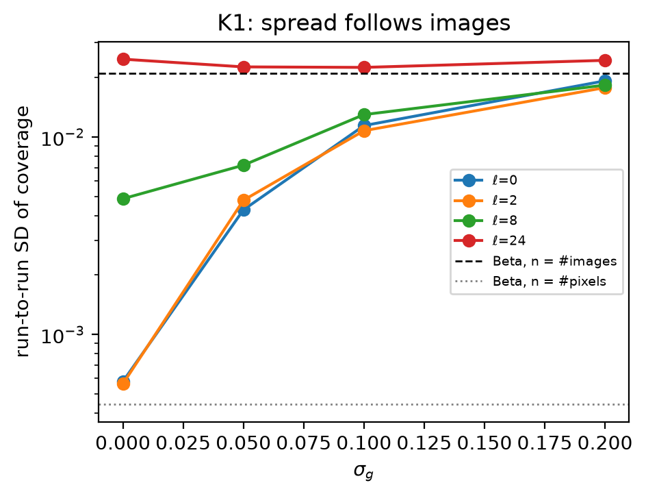
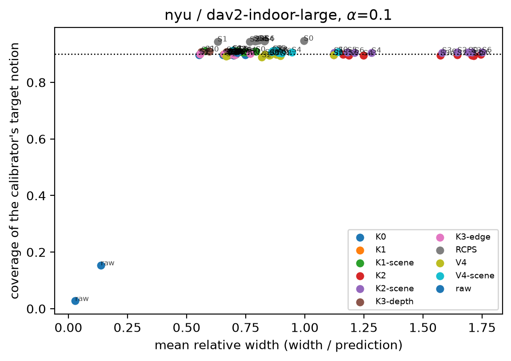
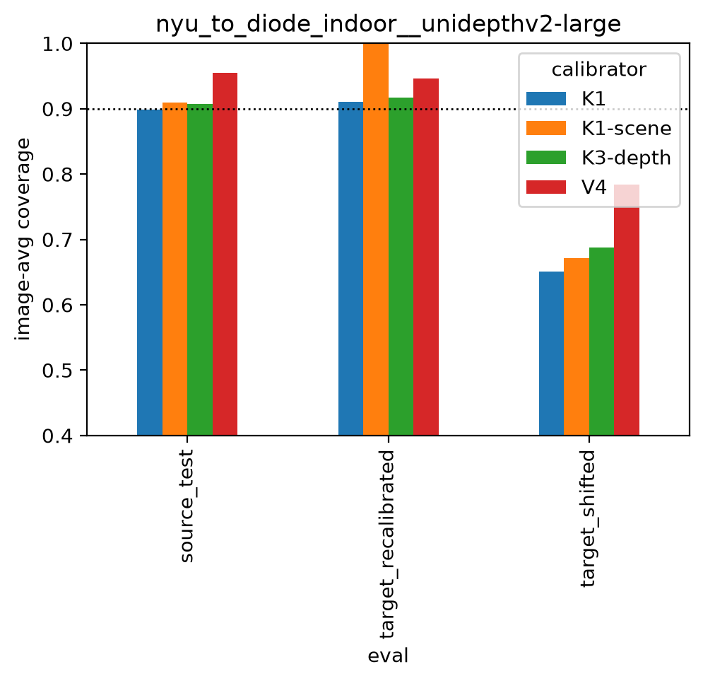
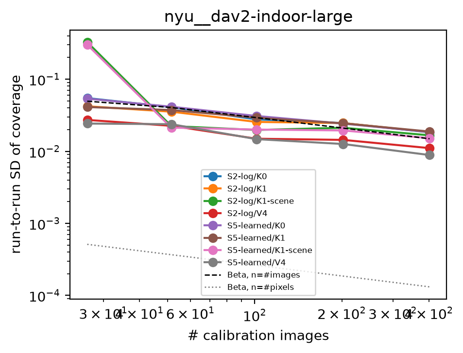
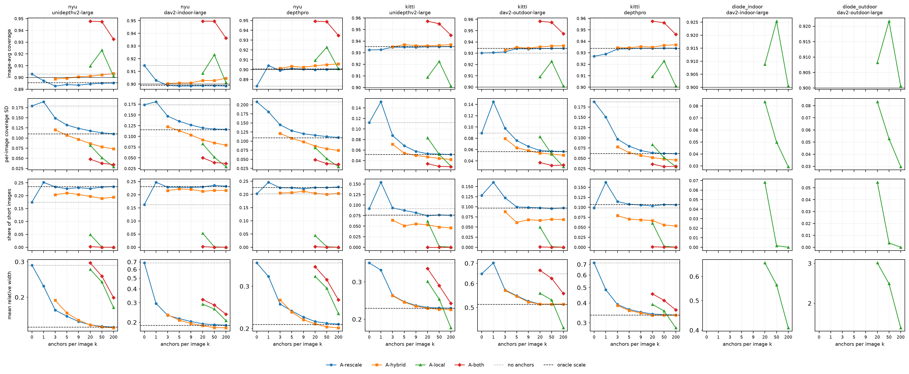
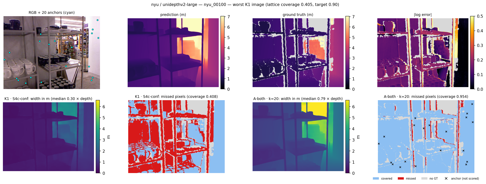
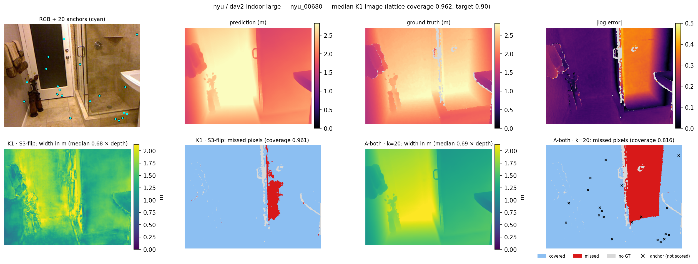
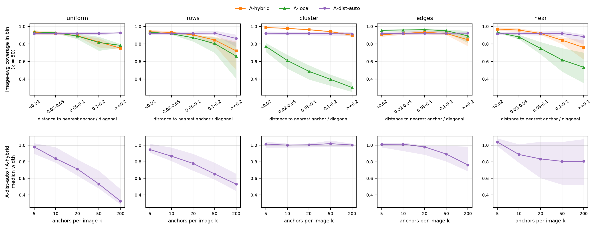

# SpaCal-Depth: Guaranteed Per-Pixel Uncertainty for Frozen Monocular Metric Depth Models

**Project report: review version, 21 October 2026.** All experiments are complete; every number below comes from the final runs (cluster jobs 43864, 43867 and 43885 for the two-model study; the Depth Pro runs of 19 October; job 44087 for the safety query E12 and structured anchors E13; job 44194 for the distance-aware anchor method E14) and was checked against the result files in `results/`. Statements that still need an external check are marked `[VERIFY]`; Appendix B lists them, together with the items checked against primary sources on 19 October 2026.

The report is written to be readable without a statistics background: §2–§3 are a short primer, and a glossary is at the end. Readers who know conformal prediction can skip to §1 (contributions), §7 (theory) and §9 (results).

---

## Abstract

Monocular metric depth foundation models predict a distance in metres for every pixel of a single photo, but give no reliable statement of how wrong they might be. We wrap three frozen models (Depth Anything V2 Metric, UniDepthV2 and Depth Pro) in **conformal prediction**, a distribution-free method that turns any predictor into per-pixel intervals with a finite-sample coverage guarantee, and evaluate on NYU Depth v2, KITTI and DIODE. Three findings shape the work. (1) Pixels are not independent samples: the run-to-run variability of coverage follows the number of calibration *images* and is two orders of magnitude larger than a pixel-count analysis predicts, so guarantees must treat the image, or the scene, as the unit. Image-level guarantees slip slightly on clustered data, and scene-level versions we add fix this at a 3–12 % width cost. (2) Without extra information, the main weakness is not average coverage (which conformal calibration delivers everywhere) but its spread across images: per-image coverage ranges from about 40 % to 100 %, and each image's global scale error explains 65–79 % of that variation. (3) Given a few true depth measurements per test image ("anchors", e.g. LiDAR points), intervals become 1.3–3.7× narrower at the same 90 % average coverage, and a combined method carries both an average and a **per-image** guarantee, cutting the share of badly covered images from 9–18 % to 0–0.2 %. When no calibration data from the target domain exists, a purely within-image method still gives exact per-image coverage, but only if the anchors are a random sample of pixels: with clustered anchors its coverage falls to 26–47 % while its intervals shrink, and only the cross-image guarantees survive. Those guarantees still lose coverage far from the anchors, so we add a distance-aware variant (A-dist) that shifts and scales each pixel by its nearby anchors and calibrates separately by distance to the nearest anchor: under all five anchor layouts tested its coverage varies across distance by 0.5–1.4 points (5–15 without the distance-aware step), and with 20 or more anchors it is narrower than the existing cross-image method by 17–67 % with random, scan-line or near-only anchors and by 2–24 % with edge anchors, and as wide (within 2 %) with clustered anchors. For a safety query (the nearest depth in a region in front of the camera), a guarantee protects only the question it was calibrated for: per-pixel and average guarantees leave the region's nearest depth over-estimated in 2–24 % of images at a 10 % target, a "whole region at once" guarantee is valid but alarms on 99–100 % of images, and calibrating the query itself (the region minimum, or every lane at once) is both valid and informative. We report limitations honestly, including structured failures (mirrors, glass) that random anchors can miss.

---

## 1. Contributions at a glance

1. **A post-hoc, guarantee-carrying wrapper for frozen monocular metric depth foundation models**, with ten calibrators covering average, high-probability, patch, group-conditional and image-event notions of validity (§6.2, §7), nine scale maps (§6.1), and a benchmark over four datasets and three models with 20 random splits per setting (§9.2, §9.14).
2. **Evidence that the image (or scene) is the right exchangeable unit** (§9.1, §9.8): synthetic and real calibration-size experiments match the image-count prediction, not the pixel-count one; image-level guarantees fall slightly short on scene-clustered data; scene-level versions of the image-event and patch guarantees (**V4-scene**, **K2-scene**) restore them (§9.3).
3. **A shape-versus-scale analysis** (§9.10): most per-image miscoverage comes from a single global scale error per image, which motivates test-time anchors.
4. **A study of conformal guarantees versus the number of test-time depth anchors** (§6.4, §7.4, §9.10–§9.12), with four methods: two with average guarantees (A-rescale, A-hybrid), a within-image method with a per-image guarantee (A-local: for every image, expected coverage over anchor draws ≥ 1 − α; the within-instance argument of Mao, Martin & Reich and of Gui, Barber & Ma, applied to depth), and their hull (A-both), which carries both by the standard union argument. The measured A-local coverage matches its exact theoretical value to three decimals on every dataset.
5. **Structured anchors** (§6.7, §9.16): with scan-line, clustered, edge or near-only anchors, A-local's per-image guarantee fails silently (coverage 0.26–0.47 under clustered anchors, with intervals narrower than under random anchors), while A-rescale, A-hybrid and A-both keep their average guarantee under every layout. Coverage also falls with distance from the nearest anchor even under random anchors.
6. **A distance-aware anchor method, A-dist** (§6.8, §7.5, §9.17): a local shift and spread from the nearest anchors, a scale that grows with distance to the nearest anchor, the anchor variant chosen on head-train, and one scene-level threshold per distance-to-anchor bin. Under all five layouts its coverage is flat across distance, and it is up to 67 % narrower than A-hybrid with random or scan-line anchors. Spending 20 of the anchors at random and taking the hull with A-local adds a per-image guarantee (0–0.3 % short images). The mechanism is standard group-conditional (Mondrian) calibration; what we add is distance to test-time metric anchors as the grouping variable, the evaluation under realistic layouts, and the budget-split rule.
7. **Matching the guarantee to the safety query** (§6.6, §9.15): on the nearest depth in a forward region, and per lane, we compare per-pixel, average, whole-region, query-level and lane-level calibration on the same data. Only guarantees calibrated on the query itself are both valid and informative; the image-versus-scene averaging unit has to match as well.
8. **Diagnostic findings**: UniDepthV2's confidence map has no absolute scale and its correlation with the error changes sign across datasets (§9.6); reflective surfaces are systematically under-covered by all methods (§9.2); raw uncertainty signals cover only 3–43 % when they claim 90 % (§9.2).

We do **not** claim to be the first conformal method for depth, nor the first image-level guarantee (Feldman et al. 2023 exist; they also fit each frame's scale and shift from 200 true depth pixels, the precedent for anchor rescaling), nor the factorised "difficulty × shape" score (VSCP has it), nor the hull construction (a union of prediction sets inheriting each set's guarantee is standard). The novelty is the combination, the anchor study and the evidence about exchangeable units (§4).

---

## 2. The problem, in plain words

### 2.1 Monocular depth estimation

"Monocular" means one camera, one photo. Humans can roughly judge distance from a single picture using cues like size, perspective and shading. Neural networks trained on millions of images can now do this too: given an RGB photo, they output a **depth map**, an image of the same size where each pixel holds a distance.

- **Relative depth** models only get the *shape* right ("the chair is closer than the wall"), not the units.
- **Metric depth** models output real metres directly. These are what robots, AR headsets and self-driving cars need. We study metric models.

### 2.2 Foundation models

A *foundation model* is a very large model trained once on huge, diverse data, then used as-is for many tasks. We use two of the strongest publicly available metric depth foundation models:

| Model | Reference | Notes |
|---|---|---|
| **Depth Anything V2 – Metric (DA-V2)**, Large | Yang et al., 2024 | Two versions: *indoor* (trained on synthetic Hypersim) and *outdoor* (trained on Virtual KITTI 2). Its Base and Small sizes form an ensemble for one of the scores. |
| **UniDepthV2**, Large | Piccinelli et al., 2025 | Trained on many datasets; also outputs a per-pixel "confidence" map. |

Both are kept **frozen**: never retrained or fine-tuned. Everything happens after the prediction ("post-hoc"), because most users can wrap a giant model but cannot retrain it.

### 2.3 Why a single number is not enough

A robot deciding whether it can drive forward needs to know whether an obstacle could be much closer than predicted. What we want is an **interval** per pixel, `[lower, upper]`, with a promise about how often the truth lands inside it. Existing uncertainty signals (UniDepth's confidence, the disagreement between predictions on an image and its mirror image, an ensemble's spread) are **not calibrated**: in our data, "90 % intervals" built from them contain the truth only 3–43 % of the time (§9.2).

---

## 3. Key ideas (a short primer)

### 3.1 Intervals, coverage and width

An interval **covers** a pixel if the true depth is inside it. **Coverage** is the fraction of covered pixels; the target is written 1 − α, so **α = 0.1** means 90 %. An interval from 0 to infinity always covers but is useless, so we also measure **relative width** (width ÷ predicted depth) and the **interval score**, which adds a penalty for misses to the width (lower is better; we use its relative version).

### 3.2 Conformal prediction

The basic "split conformal" recipe: (1) take labelled calibration data the model has not seen; (2) compute a score for each example, e.g. `|log(true) − log(predicted)|`; (3) take roughly the 90th percentile of the scores, **λ**; (4) for a new input, output `[pred · e^(−λ), pred · e^(+λ)]`. If calibration and test examples are **exchangeable** (drawn the same way, in no particular order), the new example is covered with probability at least 90 %, for any model and any data distribution, with a finite sample. §7 states the versions we use precisely.

### 3.3 Scale maps: making intervals adaptive

Dividing the error by a per-pixel **scale** `s(x)` that predicts difficulty gives the score `|log error| / s(x)` and the interval `pred · e^(±λ·s(x))`: wider where the scale says "hard". The guarantee is unchanged; only efficiency changes.

### 3.4 Pixels are not independent

If a model gets the overall size of a room wrong by 20 %, every pixel in that image is wrong together. One image is therefore closer to *one* sample than to 300,000. Treating pixels as exchangeable gives no valid guarantee, and even when *average* coverage is right, *individual images* can be covered anywhere from 40 % to 100 %. Our guarantees treat the **image**, or the **scene** (room or drive) when several images share one, as the **exchangeable unit**.

### 3.5 Kinds of guarantee ("validity notions")

| Notion | Promise, in words | Calibrator |
|---|---|---|
| none | pixels treated as exchangeable (naive baseline, no valid statement) | **K0** |
| V1 | the *expected* fraction of missed pixels in a new image is ≤ α | **K1** (conformal risk control) |
| V1-scene | the same for a new *scene*, each scene weighted equally | **K1-scene** |
| V1, high probability | V1 holds with probability ≥ 1 − δ over the calibration draw | **RCPS** |
| V2 | for each fixed image patch, the *whole* patch is covered with probability ≥ 1 − α | **K2** |
| V2-scene | V2 for a random image of a new scene | **K2-scene** (ours) |
| V3 | V1 separately inside groups (predicted-depth bins; edge vs smooth pixels) | **K3-depth**, **K3-edge** (Mondrian) |
| V4 | with probability ≥ 1 − α, a new image has at least 1 − β of its pixels covered | **V4** |
| V4-scene | V4 for a random image of a new scene | **V4-scene** (ours) |
| per-image | for *every* test image, its expected coverage over anchor draws is ≥ 1 − α | **A-local**, **A-both** (§6.4) |

### 3.6 Splits

Each random repetition ("seed") splits the data by exchangeable unit, so no room, drive or scan appears in two parts: **head-train** (30 %) fits the learned scale maps, **calibration** (35 %) sets λ, **test** (35 %) measures coverage and width. Twenty seeds per setting measure variability.

---

## 4. Prior work and positioning

Several literature searches were run and every key paper below was opened and checked.

| Work | What it does | How we differ |
|---|---|---|
| **Feldman, Ringel, Bates & Romano** (TMLR 2023, arXiv 2205.09095) | Per-pixel depth intervals on KITTI with long-run control of the average image miscoverage under online learning; a LeReS model is trained online, and 200 true depth pixels per frame fix its scale and shift | Offline, frozen metric foundation models, several validity notions, a per-image anchor guarantee; their per-frame scale/shift fit is the precedent for A-rescale |
| **Deng, Cheng, Zeller & Cremers** (arXiv 2608.29705, 2026) | Audits the native confidence of 7 frozen feed-forward 3D reconstruction models (DUSt3R and VGGT families; Marigold and UniDepthV2 separately) and compares post-hoc fixes, including four conformal refinements, one of them covariate-shift weighted; even after the best fix about 2/3 of held-out scenes are > 5 points off target; UniDepthV2 is under-confident | Monocular metric depth, image/scene-level guarantees, depth-aware scores. Their per-scene ceiling uses each scene's full labels as an oracle; A-local is a deployable version from a few anchors |
| **VSCP** (Chu, Pan & Shi, arXiv 2609.10307, 2026) | (α, β) per-view guarantee for RGB renderings of Gaussian splatting, with a "difficulty × shape" scale | Our factorised score S6 is the same idea; we do not claim it |
| **Dong & Li** (Pattern Recognition 2026) | Conformalized confidence calibration for multi-view 3D reconstruction; marginal coverage under scene-level exchangeability | Single-image metric models; the scene-as-unit argument is shared, not claimed |
| **Angelopoulos et al., im2im-uq** (ICML 2022) | Per-pixel intervals with image-averaged risk control | Template for V1; we apply it |
| **Mao, Martin & Reich** (JASA 2024, arXiv 2006.15640) | Randomly sampled locations of one spatial field are exchangeable, so conformal prediction works inside one field | The argument behind A-local; cited as theirs |
| **Gui, Barber & Ma** (NeurIPS 2023, arXiv 2305.10637) | Conformalized matrix completion: observed and unobserved entries of one matrix are (weighted) exchangeable, so calibration happens inside one instance; a weighted version handles non-uniform sampling | The same within-instance argument as A-local. Weighting cannot repair anchor patterns that give some pixels zero chance of being an anchor |
| **Gibbs, Cherian & Candès** (arXiv 2305.12616) | Guarantees that interpolate between marginal and conditional validity | Our per-image guarantee comes instead from test-time anchors |
| **MRAC** (Roy et al., arXiv 2607.04101, 2026) | Calibrates a frozen relative-depth model (DA-V2) to metric depth with 5–200 sparse anchors through a small residual head, robust to corrupted anchors; **no coverage guarantee** | We add guarantees and study coverage vs anchor count |
| **Noonan** (arXiv 2608.21262, 2026) | Generic result: clustering multiplies the variance of threshold-exceedance estimates by a design effect | Supports the scene as unit (our application of it) |
| Lee, Barber & Willett; Dunn, Wasserman & Ramdas | Hierarchical / two-layer conformal prediction | Theory behind the scene-level calibrators |

**Safety-oriented and spatial-sampling work.** These relate to the experiments added after review, the safety query (E12, §9.15) and structured anchors (E13, §9.16).

| Work | What it does | How we differ |
|---|---|---|
| **Lindemann, Cleaveland, Shim & Pappas** (RA-L 2023, arXiv 2210.10254); **Dixit et al.** (L4DC 2023, arXiv 2212.00278) | Conformal prediction regions for forecast agent trajectories, used for safe (and adaptive, online) motion planning | Static geometry from a single image, not trajectory forecasts |
| **Mei, Dixit et al., Perceive With Confidence** (CoRL 2024, arXiv 2403.08185) | Calibrates an environment-level enclosing score for occupancy perception; averaged calibration violates the misdetection target | The analogous argument for dense monocular depth and region nearest-depth queries, comparing several guarantee types on the same query |
| **Luo et al.** (IJRR 2024, arXiv 2109.14082) | Warning systems with a provable false-negative rate over unsafe situations, reporting the false-alarm cost | Our danger-conditional calibration (danger-CRC) follows this, over the pixels of a dense depth map |
| **Shin, Ra & Yang** (arXiv 2607.00776, 2026) | A field-level, one-sided conformal lower bound on predicted distance fields for planning | Depth maps from a frozen model, not pedestrian distance fields |
| **Kim & Kim, SCORE** (arXiv 2608.15289, 2026) | One-sided clearance score in the unsafe direction, calibrated per voxel | Per-voxel calibration does not protect a query over a whole region |
| **Davenport** (arXiv 2410.03406); **Mossina & Friedrich** (arXiv 2503.05618, 2511.15406) | Per-image maximum scores giving image-level guarantees in segmentation | The same construction applied to one-sided depth errors inside a region of interest |
| **Lekeufack et al., Conformal Decision Theory** (ICRA 2024, arXiv 2310.05921) | Calibrates decisions directly; argues simultaneous coverage is often excessive | We keep intervals and use a region-level event, between per-pixel and full simultaneous coverage |
| **Wen, Ahmad & Schniter** (ECCV 2024, arXiv 2405.18527) | Task-driven conformal UQ: the guarantee targets a downstream task output | The same principle, for depth safety queries |
| **Sen & Saha** (arXiv 2610.10168, 2026); **Wieczorek** (Survey Methodology 2023, arXiv 2303.01422); **Lunde** (arXiv 2306.07252) | Conformal coverage under spatial dependence, survey sampling designs and non-uniform sampling | We measure how realistic anchor patterns (scan lines, clusters, edges, near-only) break the within-image guarantee in practice |

**Localized and group-conditional work.** These relate to the distance-aware anchor method (A-dist, §6.8, §9.17), whose statistical mechanism is not new.

| Work | What it does | How we differ |
|---|---|---|
| **Vovk, Gammerman & Shafer** (2005), Mondrian conformal prediction | Separate calibration within groups defined by the input gives per-group validity | A-dist's groups are distance-to-anchor bins, calibrated over scenes |
| **Guan** (Biometrika 2023) | Localized conformal prediction: calibration points weighted by their distance to the test point in feature space | The same localisation idea; we localise by distance to test-time metric anchors, with fixed groups shared across images instead of per-test-point weights |
| **Gibbs, Cherian & Candès** (arXiv 2305.12616) | Coverage guaranteed over a class of covariate-defined shifts, including group-conditional coverage | A-dist's per-bin guarantee is a special case with groups defined by anchor geometry |
| **Bairaktari, Wu & Wu, Kandinsky CP** (ICML 2025, arXiv 2502.17264) `[VERIFY: authors]` | Group-conditional coverage for overlapping, fractional groups | Fixed, disjoint distance bins are a simple special case |
| **Jiang & Xie, LSCP** (arXiv 2412.01098) `[VERIFY: venue]` | Spatial conformal inference within one spatial field, from residuals near the new location | Mechanically close to A-dist's local shift and distance-aware scale, but calibrated within one field under spatial exchangeability, the precondition A-local needs and E13 breaks; closer to A-local than to A-dist's cross-image guarantee. Not yet run as a baseline |

**What we claim and what we do not.** We do not claim the first conformal depth method, the first image-level guarantee, the hull construction, region-level safety calibration in general, or distance- and locality-based group-conditional calibration (A-dist's mechanism). We claim the combination in §1: a guarantee-carrying wrapper for frozen monocular metric depth models with several validity notions, evidence about the exchangeable unit with scene-level fixes, a characterisation of coverage versus test-time anchors including a method with both an average and a per-image guarantee, and, for structured anchors, distance to the nearest anchor as the calibration group with a budget-split rule for keeping the per-image guarantee. The closest papers are 2026 preprints; the search was repeated on 19 October 2026 (the works added above) and must be repeated before submission `[VERIFY]`.

---

## 5. Data

| Dataset | Units (scenes) | Images | Depth sensor |
|---|---|---|---|
| **NYU Depth v2**, labelled set | 464 rooms | 1,449 | Kinect (indoor), max 10 m |
| **KITTI**, Eigen test (652) + 800 Eigen-train frames | 61 drives | 1,452 | LiDAR (sparse, outdoor) |
| **DIODE indoor**, validation | 10 scans (3 scenes) | 325 | Laser scanner |
| **DIODE outdoor**, validation | 10 scans (3 scenes) | 446 | Laser scanner |

None were used to train any of the three models, so all testing is zero-shot. DIODE's file names encode a scan number; we use the scan as its unit (10 per domain instead of 3 scenes). Valid pixels are kept on a regular grid (every 4th pixel on NYU, every 2nd on KITTI and DIODE), giving 14–24 million pixels per dataset/model pair, stored per image (a **PixelTable**) so per-image statistics are exact.

---

## 6. Methods

### 6.1 Scores (how difficulty is estimated)

All scores work on the log residual `d = log y − log ŷ` except S0 (metres). The interval is `ŷ · exp(±λ s(x))`.

| Code | Scale `s(x)` | Idea |
|---|---|---|
| S0-const | 1 (metres) | constant absolute error |
| S1-rel | predicted depth | error grows with distance |
| S2-log | 1 (log space) | constant relative error |
| S3-flip | disagreement between prediction on the image and on its mirror | test-time augmentation |
| S3e-ens | spread of DA-V2 Small / Base / Large | model ensemble |
| S4-grad | gradient-based uncertainty (GrUMoDepth-style) | network sensitivity |
| S4c-conf | UniDepthV2's confidence map | native uncertainty |
| S5-learned | gradient-boosted trees fit on head-train to the 90th percentile of the error from pixel and image features | learned uncertainty |
| S6-fact (+conf, +flip variants) | `a(image) × b(pixel)`: an image difficulty times a within-image shape | separates "how wrong is this image" from "where" |

Heuristic scales (S3, S4, S4c) learn on head-train a compressing transform (identity, square root or log) and a floor, so heavy-tailed signals cannot produce absurd widths. S6's image factor is clipped to the 1st–99th percentile of head-train targets and the product is capped at the 99.9th percentile of head-train errors (§9.4).

### 6.2 Calibrators

K0, K1, K1-scene, RCPS, K2, K2-scene, K3-depth, K3-edge, V4, V4-scene (table in §3.5). Settings: α ∈ {0.05, 0.1, 0.2}; β = 0.1 for V4; δ = 0.1 for RCPS; K2 uses a fixed 4 × 4 patch grid; K3-depth bins are < 1.5, 1.5–3, 3–5, ≥ 5 m indoors and < 10, 10–20, 20–40, ≥ 40 m outdoors. Conformal risk control is solved exactly (not on a grid).

### 6.3 Raw baselines (no conformal step)

`ŷ · exp(±1.645 σ)` (a nominal 90 % Gaussian interval) with σ from the flip disagreement, the ensemble spread, or a learned variance head. UniDepth's confidence was dropped as a raw baseline because it has no absolute scale (§9.6).

### 6.4 Sparse anchors (E11)

Each test image comes with **k anchors**: a uniformly random subset of its valid ground-truth pixels (on KITTI these are real LiDAR returns). Calibration images receive anchors drawn the same way. All methods are evaluated only on non-anchor pixels; k ∈ {0, 1, 3, 5, 9, 20, 50, 200}.

| Method | What it does | Guarantee (§7.4) |
|---|---|---|
| **A-rescale** | shift the prediction by the anchors' median log error, then calibrate across images (scene-level CRC) | average over new scenes |
| **A-hybrid** | also divide each pixel's score by the image's anchor-estimated error spread (leave-one-out median absolute deviation, plus a floor τ chosen on head-train) | average over new scenes |
| **A-local** | inside the image only: half the anchors fix the shift, the other half set the width by split conformal; no calibration set; plain log score | **per image**; needs ≥ 18 anchors at α = 0.1 |
| **A-both** | pointwise union (hull) of A-hybrid and A-local | **both** |

An **oracle** row removes each image's true global scale error (the k → ∞ limit of rescaling).

### 6.5 Decision rule

Method A **beats** baseline B in a (dataset, model, α) cell if (1) A is valid: the mean of its own target notion over seeds is at least 1 − α minus two run-to-run standard errors, and (2) the paired (same-seed) difference in relative interval score has a 95 % bootstrap confidence interval entirely below 0. Baselines: S2-log/K1, S1-rel/K1, S3-flip/K1.

### 6.6 Safety queries (E12)

The query is the **nearest true depth inside a fixed forward region of interest (ROI)**, and inside each of its 3 lanes (equal-width column strips). The ROI is fixed in image coordinates: on KITTI the top quarter of the Garg crop (which starts near the horizon) and the middle third of the columns; on NYU rows 20–80 % and columns 25–75 %. Every method produces a per-pixel lower bound L = ŷ · e^(−λ s); the region bound is the minimum of L over the region's valid pixels, and it is **violated** when it exceeds the true region minimum (the system would say "clear" further out than the nearest real surface). A decision rule "brake if the bound is below D" is scored at D ∈ {10, 15, 20} m (KITTI) and {1, 1.5, 2, 2.5} m (NYU): a **miss** is a truly dangerous image (true minimum < D) that is not flagged, a **false alarm** a safe image that is.

| Method | Calibrated on | Guarantee |
|---|---|---|
| point | – (λ = 0) | none |
| K1-2s, V4-2s | lower end of the main study's two-sided K1 / V4 intervals | per-pixel average / image event; not about the region minimum |
| K1-lower | one-sided CRC on ROI pixels | E[share of ROI pixels below L] ≤ α |
| A-both-k20 | E11's A-both with 20 random anchors (anchors keep their measured depth) | average and per-image pixel coverage; not about the region minimum |
| ROI-event | split CP on max over ROI pixels of (log ŷ − log y) / s | P(any ROI pixel below its bound) ≤ α: every region and lane bound holds at once |
| task-scalar | split CP on log min_ROI ŷ − log min_ROI y | P(region minimum over-estimated) ≤ α; no lane guarantee |
| lane-event | split CP on the max over lanes of (log min_lane ŷ − log min_lane y) | P(any lane minimum over-estimated) ≤ α, hence also the ROI minimum |
| danger-CRC@D | CRC on the share of truly dangerous ROI pixels (y < D) that "flag if L < D" misses, over images containing danger | E[missed share \| image contains danger] ≤ α |
| *-scene | the same with CRC over scenes (T2) | the guarantee holds for the **scene-averaged** rate |

The image-level methods are T3-type split conformal guarantees on one scalar per image; the scene versions apply T2 to the per-image indicator. 20 seeds, α ∈ {0.05, 0.1}, plain log score and learned score as bases.

### 6.7 Structured anchors (E13)

E11's anchors are a uniformly random subset of valid pixels, which is what A-local's guarantee (T8) assumes. Real sensors are not random, so E13 reruns E11 with four structured layouts, computed from the image only (row, column, edge map, predicted depth), never from the true depth:

| Layout | Anchors are drawn from |
|---|---|
| rows | 4 random image rows (a sparse scan-line sensor) |
| cluster | the pixels nearest a random centre (one patch observed) |
| edges | predicted-depth edge pixels |
| near | the 30 % of pixels with the smallest predicted depth |

Calibration and test images use the same layout, so the cross-image guarantees of A-rescale and A-hybrid (T7) still apply; A-local's within-image argument does not. Settings: k ∈ {20, 50, 200}, 5 seeds × 3 anchor draws, plain log score, α = 0.1, all six NYU/KITTI pairs. Coverage is also broken down by each pixel's distance to its nearest anchor, as a fraction of the image diagonal.

### 6.8 Distance-aware anchors (A-dist, E14)

E13 showed that A-hybrid's coverage falls with distance to the nearest anchor (§9.16, Finding 3): one shift and one spread per image fit the pixels near the anchors better than those far away. A-dist (`src/calibrators/anchor_dist.py`, design in `docs/ANCHOR_METHOD_PROPOSAL.md`) makes both local and calibrates separately by distance. For pixel x of an image with anchors:

- **Local shift m(x)**, one of four variants: *median* (the image's median anchor residual, as A-hybrid), *knn* (median of the K = 16 nearest anchors), *kernel* (Gaussian-weighted mean of the 16 nearest, bandwidth h), *bilateral* (kernel weights times a similarity in log predicted depth, bandwidth h_d, so anchors on the same surface dominate).
- **Spread σ(x)**: the median absolute deviation of the 16 nearest anchors' residuals around their own median (for the median variant, the image's leave-one-out spread, as A-hybrid).
- **Distance δ(x)** to the nearest anchor, as a fraction of the image diagonal.
- **Scale** s(x) = b(x) · (σ(x) + τ) · g(δ(x)), with b the base score map (1 or the learned S5-shape map), a floor τ and a non-decreasing g fitted by isotonic regression of the normalised error against δ. s is capped at its 99.9th percentile on head-train: widths are e^(λ s), and without the cap a product of three factors put intervals e^10 wide on a few pixels.
- **Calibration**: score r = |d − m(x)| / s(x); one scene-level CRC threshold λ_b per distance bin b ∈ {< 0.02, 0.02–0.05, 0.05–0.1, 0.1–0.2, ≥ 0.2}, over the calibration images with at least 10 pixels in the bin. A bin is merged into its nearer neighbour if fewer than 5 % of head-train images have 10 pixels in it, or if fewer than 2/α − 1 = 19 calibration scenes have 10 pixels in it (below that the CRC budget is less than one scene's loss and λ_b becomes the bin's largest residual, or infinite below 9 scenes). Merging looks only at where calibration pixels lie, never at their residuals.

Everything except λ is fitted on 200 head-train images, never on calibration data: per anchor draw the bandwidths (h ∈ {0.05, 0.1, 0.2}, h_d ∈ {0.1, 0.3}) by held-out log interval score on the plain log score, and per base and α the floor τ, g, the head-train merges and the cap. **A-dist-auto** picks, per draw, the variant with the best head-train score. With the median variant, one bin and g ≡ 1, A-dist is exactly A-hybrid (a unit test checks this).

**Budget split.** When k > 20, a second draw places k − 20 anchors by the layout and 20 uniformly at random, and adds:

| Method | What it does | Guarantee (§7.5) |
|---|---|---|
| **A-local-split** | A-local on the 20 random anchors | per image (T8) |
| **A-dist-split** | A-dist-auto on all k anchors of the split draw | per distance bin, average over scenes |
| **A-dist-both** | hull of A-dist-split and A-local-split | both |
| A-hybrid-split, A-both-split | A-hybrid and its hull with A-local-split on the same draw | references for the two above |

Settings: all six NYU/KITTI pairs × the five layouts of §6.7, k ∈ {5, 10, 20, 50, 200}, 3 seeds × 2 anchor draws, plain log (S2-log) and learned (S5-shape) bases, α = 0.1. The success and kill criteria were fixed before running (proposal §7.6): **S1** per-bin coverage ≥ 1 − α − 2 SE in every bin with ≥ 20 test images; **S2** median width ≤ A-hybrid's on at least 4 of 6 pairs for the uniform and rows layouts; **S3** fewer short images than A-hybrid; **kill** if the width is more than 10 % above A-hybrid everywhere.

---

## 7. Theory: what each method guarantees, and why

**Notation.** Image i has valid pixel set P_i, prediction ŷ, truth y, log residual d = log y − log ŷ, scale s(x) and normalised score r = |d| / s. The interval at level λ is C_λ(x) = [ŷ e^(−λ s(x)), ŷ e^(λ s(x))], so pixel j is covered iff r_j ≤ λ. The per-image miscoverage loss is L_i(λ) = |{j ∈ P_i : r_j > λ}| / |P_i|, which lies in [0, 1] and is non-increasing in λ. All guarantees are over the random calibration/test draw; "unit" means image, scene or scan as stated.

### 7.1 Average (marginal) guarantees

**T1 – Conformal risk control (K1).** Let the n calibration units and the test unit be exchangeable, and let λ̂ = inf{λ : (Σ_i L_i(λ) + 1) / (n + 1) ≤ α}. Then E[L_test(λ̂)] ≤ α. *Why:* this is Theorem 1 of Angelopoulos et al. (ICLR 2024) with loss bound B = 1; the losses are monotone and bounded, and exchangeability makes the test loss no worse in expectation than the calibration losses plus the one-unit slack. The condition is feasible only if (n + 1) α ≥ 1, i.e. **n ≥ 1/α − 1** units (9 at α = 0.1, 19 at α = 0.05). For near-continuous losses the guarantee is nearly tight (over-coverage at most about 2/(n + 1)), which is why K1 sits just at the target on NYU and KITTI.

**T2 – Scene-level risk control (K1-scene, V4-scene, K2-scene, A-rescale, A-hybrid).** Apply T1 with the scene as the unit and the unit loss equal to the mean loss of its images. Then the expected *scene-averaged* loss of a new scene is ≤ α; equivalently, for a random image of a random new scene (each scene weighted equally) the expected loss is ≤ α. *Why this matters:* images of one room or drive are correlated, so images are not exchangeable across scenes and T1 at the image level is only approximately valid. Scenes, by the split design, are. This is the two-layer hierarchical setting of Dunn, Wasserman & Ramdas and Lee, Barber & Willett. Feasibility needs ≥ 1/α − 1 calibration *scenes*: NYU (~160 per split) and KITTI (~21) qualify at α = 0.1; DIODE (3–4 scans) does not, and the code returns honest infinite intervals. With few units the threshold rounds up, so KITTI over-covers (0.93–0.94). A Monte-Carlo test on clustered synthetic data (`tests/test_split_cp.py`) shows the difference: image-level calibration covered 0.866 of new-scene images, scene-level 0.927, target 0.90.
- **V4-scene** uses the per-image binary loss 1{image coverage < 1 − β}; **K2-scene** uses, per patch, 1{patch not fully covered}.

**T3 – Image event (V4).** Give image i the single score S_i = the ⌈|P_i|(1 − β)⌉-th smallest r_j, so λ ≥ S_i iff at least 1 − β of its pixels are covered. Split conformal over images then gives P(test image coverage ≥ 1 − β) ≥ 1 − α, and at most 1 − α + 1/(n + 1) without ties (Vovk et al. 2005; Lei et al. 2018).

**T4 – Patch guarantee (K2).** For each fixed patch p (a function of pixel position only), score S_ip = max of r_j over the patch's valid pixels; split conformal per patch gives P(every valid pixel of patch p is covered) ≥ 1 − α, separately for each patch.

**T5 – Mondrian (K3).** Group labels are computed from the input only (predicted depth, predicted-depth edges). Running T1 separately within each group, over images that have enough pixels in it, gives E[group-g miscoverage of a new image] ≤ α for every group g (Vovk et al. 2005).

**T6 – High-probability risk control (RCPS).** With a Hoeffding upper confidence bound, P(E[L(λ̂)] > α) ≤ δ (Bates et al., JACM 2021). It needs n ≥ log(1/δ) / (2α²) images to be feasible: **115** at α = 0.1 and **461** at α = 0.05 (δ = 0.1). This explains the infinite RCPS intervals on DIODE and on KITTI at α = 0.05 (§9.2).

**K0** treats pixels as exchangeable; under within-image correlation it carries no valid statement and is reported only as the naive baseline.

### 7.2 Why the image is the unit: the calibration-size prediction

For split conformal with n exchangeable scores, the coverage of a calibrated threshold, as a random variable over calibration draws, follows a Beta distribution whose spread shrinks like 1/√n. If pixels were the unit, n would be millions and coverage would barely vary between seeds; if images are, n is in the hundreds. E1 and E8 test which n applies (§9.1, §9.8).

### 7.3 Anchors as test-time features

Anchors are random, but drawn by the same mechanism for calibration and test images. The per-image shift m_i (median anchor residual) and spread σ_i are functions of the image and its anchor set, and s(x) is computed from the prediction only.

**T7 – A-rescale and A-hybrid.** Treat (image, anchor set, evaluation pixels) as the data of a unit. Calibration and test scenes remain exchangeable, so T2 applies to the normalised scores |d − m_i| / s(x) (A-rescale) or |d − m_i| / (s(x)(σ_i + τ)) (A-hybrid) on non-anchor pixels. τ is chosen on head-train, independently of calibration, so the guarantee is unaffected. The guarantee is **average**: it says nothing about a particular image.

### 7.4 A per-image guarantee from within-image exchangeability

**T8 – A-local.** Fix an image i and its finite set of valid ground-truth pixels P_i. Draw k anchors uniformly at random and split them at random into a shift half A_s (⌊k/2⌋ pixels) and a calibration half A_c (k_c = k − ⌊k/2⌋ pixels). Let m = median of d over A_s, scores r_j = |d_j − m| (s = 1), and q̂ = the ⌈(k_c + 1)(1 − α)⌉-th smallest score in A_c (infinite if that rank exceeds k_c). Then, for a uniformly random non-anchor pixel J,

  P(r_J ≤ q̂ | image i) = ⌈(k_c + 1)(1 − α)⌉ / (k_c + 1) ≥ 1 − α  (exactly, when scores have no ties).

*Why:* given A_s, the set A_c ∪ {J} is a uniformly random (k_c + 1)-subset of the remaining pixels, with J in a uniformly random position, so the rank of r_J among these k_c + 1 scores is uniform on {1, …, k_c + 1}. This is the within-field exchangeability argument of Mao, Martin & Reich (Lemma 1); no other image and no calibration set is involved. Taking the expectation over J, **the expected coverage of image i's non-anchor pixels over anchor draws is at least 1 − α, for every image**. Feasibility: k_c ≥ 1/α − 1, i.e. **k ≥ 18** at α = 0.1 and k ≥ 38 at α = 0.05.

*Scope:* (a) the promise is in expectation over anchor draws; a single draw can miss a structured region (§9.12). (b) It covers a random *valid ground-truth* pixel; on KITTI that means pixels with a LiDAR return. (c) s must not depend on anchor values; with a learned s the threshold, essentially the largest of ~10 normalised anchor scores, became unstable (§9.11), so A-local always uses s = 1.

*Empirical check:* the predicted coverage is 10/11 = 0.909 at k = 20, 24/26 = 0.923 at k = 50 and 91/101 = 0.901 at k = 200. Measured on the six dataset/model pairs: 0.908–0.910, 0.922–0.925 and 0.900–0.901 (§9.10).

**T9 – A-both.** The hull of two intervals contains each of them pointwise, so every pixel covered by A-hybrid or by A-local is covered by A-both. A-both therefore inherits **both** T7 and T8, at the cost of width up to their union. This is the standard union argument (e.g. Gasparin & Ramdas); what we add is measuring when the hull is narrow enough to be useful (§9.10–§9.11).

### 7.5 Distance-aware anchors

**T10 – A-dist (per distance bin).** Fix the anchor rule (layout and k) and apply it independently to every image; fit the variant, bandwidths, τ, g, the head-train merges and the cap on head-train only. For a bin b, an image's loss is the share of its bin-b evaluation pixels with r > λ, and an image enters bin b if it has at least 10 evaluation pixels there. The selection rule is the same function of each scene, so the scenes selected for bin b remain exchangeable, and T2 applied within the bin (the Mondrian argument of T5) gives

  E[scene-averaged bin-b miscoverage of a new scene's images] ≤ α, for every bin b.

The anchors' measured residuals enter m and s; that is allowed, because the test image's anchors are observed at test time, as in T7. Feasibility needs 9 calibration scenes per bin at α = 0.1.

*Scope:* (a) **Merged bins.** A bin with fewer than 19 calibration scenes shares its neighbour's threshold, and the guarantee then holds for the merged bin, not for each part. The merge depends on calibration pixel positions (not residuals), which departs slightly from fixing the groups before seeing calibration data: the test scene does not enter the count. (b) The guarantee is an average over scenes, like T7; it says nothing about one image. (c) Calibration and test must use the same anchor rule; a layout change between calibration and deployment is not covered.

**T11 – A-dist-both.** With k − 20 structured and 20 uniformly random anchors, A-local on the random 20 keeps T8 exactly (k_c = 10, so 10/11 = 0.909 for every image, in expectation over the random anchors), and A-dist on all k keeps T10. Their hull inherits both (T9). This is the constructive side of a simple fact: a pixel that can never be an anchor (far from a cluster, off an edge) gets no per-image guarantee from that image's anchors alone, so per-image guarantees need some anchors placed at random.

---

## 8. Experiments

| ID | Question | Script | Size |
|---|---|---|---|
| **E0** | How accurate are the base models on our data? | `experiments/e0_base_metrics.py` | official test subsets |
| **E1** | On synthetic data with known truth, do the guarantees behave as theory says, and does coverage spread follow images or pixels? | `experiments/e1_synthetic.py` | 100 reps per setting |
| **Main** (E2–E4, E6, E9) | Which scores and calibrators give the best valid intervals; conditional coverage; raw vs conformal; α sweep | `experiments/run_calibration.py` | 6 pairs (+ 4 Depth Pro pairs) × up to 9 scores × 10 calibrators × 3 α × 20 seeds |
| **E5** | Does a guarantee survive domain shift (NYU → DIODE indoor, KITTI → DIODE outdoor), and does recalibration restore it? | `experiments/e5_shift.py` | 4 settings (+ 2 Depth Pro) × 10 seeds |
| **E8** | How does coverage variability depend on calibration size: images or pixels? | `experiments/e8_calsize.py` | NYU, KITTI × 50 seeds |
| **E10** | Cost in milliseconds | `experiments/e10_cost.py` | – |
| **E11** | Coverage, spread and width versus the number of anchors k | `experiments/e11_anchors.py` | 6 pairs (+ NYU, KITTI with Depth Pro) × 8 k × 5 seeds × 6 anchor draws |
| **E12** | Does the interval protect a safety query (nearest depth in a forward region, per lane), and at what false-alarm cost? | `experiments/e12_safety.py` | NYU, KITTI × 3 models × 2 α × 20 seeds |
| **E13** | Do the anchor guarantees survive structured (non-random) anchors? | `experiments/e11_anchors.py --pattern` | NYU, KITTI × 3 models × 5 layouts × 3 k × 5 seeds × 3 draws |
| **E14** | Does a distance-aware anchor method keep coverage even across distance to the nearest anchor, at what width, and does a budget split restore the per-image guarantee? | `experiments/e11_anchors.py --dist-kinds` | NYU, KITTI × 3 models × 5 layouts × 5 k × 3 seeds × 2 draws × 2 bases |
| diagnostics | Units per dataset; what UniDepth's confidence measures | `experiments/diag_tables.py` | – |

---

## 9. Results

### 9.1 E0 and E1: base accuracy and a synthetic check

**E0.** AbsRel = mean relative error (lower is better); δ1 = share of pixels within 25 % of the truth.

| Dataset | Model | AbsRel | δ1 |
|---|---|---|---|
| NYU | UniDepthV2-L | 0.071 | 0.963 |
| NYU | DA-V2-L indoor | 0.206 | 0.697 |
| KITTI | UniDepthV2-L | 0.077 | 0.962 |
| KITTI | DA-V2-L outdoor | 0.109 | 0.882 |
| NYU | Depth Pro | 0.092 | 0.935 |
| KITTI | Depth Pro | 0.139 | 0.840 |
| DIODE indoor | DA-V2-L / UniDepthV2-L / Depth Pro | 0.220 / 0.171 / 0.204 | – |
| DIODE outdoor | DA-V2-L / UniDepthV2-L / Depth Pro | 0.74 / 1.11 / 0.52 | – |

UniDepthV2 is much stronger; Depth Pro sits between the two (closer to UniDepthV2 on NYU, behind DA-V2 on KITTI in AbsRel). Our predictions match the official Hugging Face pipeline to three decimals. DA-V2's published NYU numbers (δ1 0.984) come from a model fine-tuned on NYU; the released Hypersim-only metric model has no official zero-shot NYU number, so our δ1 of 0.70 cannot be compared with the authors'. DIODE outdoor is very hard for all three models.

**E1.** On synthetic images with a controllable global scale error σ_g, K0 and K1 pick nearly the same λ (0.366 vs 0.371 at σ_g = 0.2), and V4 hits its target exactly (0.898–0.900) at every σ_g. Per-image coverage spread grows from 0.006 to 0.195 as σ_g goes from 0 to 0.2, although average coverage stays at 0.90: average validity says nothing about individual images. Run-to-run spread follows the Beta prediction with n = number of images, not pixels.



### 9.2 Main study (20 seeds)

**Validity.** K1 meets its target on every NYU and KITTI pair at every α: 0.945–0.949 at α = 0.05, 0.894–0.900 at α = 0.1 and 0.797–0.800 at α = 0.2 (plain log score), within about two standard errors. On DIODE, with only 10 scans, per-seed coverage varies a lot (SD ≈ 0.10 on DIODE indoor) and the average is 0.888 at α = 0.1, inside the tolerance but with a caveat.

**Raw uncertainty is badly miscalibrated** (nominal 90 %, α = 0.1):

| Raw interval | Coverage across pairs |
|---|---|
| Flip disagreement | 3–16 % |
| DA-V2 ensemble spread | 15–43 % |
| Learned variance head | 83–91 % (meets 90 % on one pair only; no guarantee) |

**The best score depends on the dataset.** Best valid K1 score by relative interval score (α = 0.1), with the paired-bootstrap improvement over the plain log score (S2-log/K1; all significant):

| Pair | Best score | Improvement | Other significant winners |
|---|---|---|---|
| KITTI, DA-V2 | S5-learned | −0.196 | S6, ensemble, flip, gradient, relative |
| KITTI, UniDepth | S5-learned | −0.088 | S6, flip, relative, S6-conf |
| NYU, DA-V2 | S1-rel | −0.119 | S5, ensemble (small) |
| NYU, UniDepth | S5-learned | −0.022 | S6 variants, flip, relative, confidence (all small) |
| DIODE indoor | S4-grad | −0.073 | ensemble, flip |
| DIODE outdoor | S1-rel | −1.756 | constant, ensemble, flip |

The winner is the same at all three α levels on four of six pairs; on NYU UniDepth and DIODE indoor the top two swap places between α levels, with differences of 0.01–0.05. Learned scores pay off when the head-train data are large and in-domain (KITTI); on NYU with DA-V2, whose errors are dominated by a global scale bias, the simple relative score wins.

**Stricter guarantees cost width** (S2-log, α = 0.1, relative to K1): V4 +24–51 %, RCPS +17–31 %, K2 2.5–6×. RCPS is infinite on DIODE (too few calibration images, §7.1 T6), and at α = 0.05 on NYU it is already 2–5× wider than K1.

**Conditional coverage (Mondrian).** Worst depth-bin shortfall below target (α = 0.1):

| Pair | S2-log/K1 | S2-log/K3-depth | S2-log/K3-edge | S5-learned/K1 |
|---|---|---|---|---|
| KITTI, UniDepth | 0.199 | **0.046** | 0.147 | 0.022 |
| KITTI, DA-V2 | 0.101 | **0.055** | 0.064 | 0.018 |
| NYU, UniDepth | 0.115 | **0.074** | 0.114 | 0.012 |
| NYU, DA-V2 | 0.069 | **0.054** | 0.067 | 0.016 |
| DIODE outdoor | 0.135 | **0.085** | 0.094 | 0.051 |

K3-depth shrinks the worst-group gap substantially, at no width cost on KITTI, 2–7 % on NYU and up to 25 % on DIODE indoor. K3-edge helps less. A learned score already nearly equalises depth bins (gap 0.01–0.02), so on top of it Mondrian adds little.

**Reflective surfaces are systematically under-covered.** NYU provides semantic labels; coverage restricted to mirror pixels under S2-log/K1 is **0.41** (UniDepth) and **0.62** (DA-V2), against 0.88–0.91 on windows. Mondrian by depth does not help (0.42 / 0.63); even the stricter V4-scene only reaches 0.48 / 0.71. The error there is structured: the model may predict the depth of the reflected scene, and sensor depth on mirrors is itself unreliable, so no score computed from the prediction alone can flag it. (Glass is labelled in only ~2 test images per split, too few to measure.)

**The unit matters, but not as originally expected.** Treating pixels as the unit (K0) instead of images (K1) barely changes per-image spread (SD ≈ 0.19 on NYU under both); the original plan's hypothesis "K0 is much more variable" is **not** supported. The real weakness is the spread of per-image coverage itself, which motivates anchors.



*Each point is a score/calibrator pair; x = median relative width (log scale), y = coverage of the calibrator's own target notion; dotted line = 90 % target. Raw baselines are off the bottom of the plot.*

### 9.3 Scene-level guarantees

On NYU, K1 meets the image-averaged target (0.9001) but misses the scene-averaged one (0.891, about 2.7 standard errors short): small rooms are harder. In the same direction, V4 and K2 land 0.004–0.01 below target on every real pair while hitting it exactly on synthetic independent data. V4-scene and K2-scene (T2) fix this.

Share of test images with ≥ 90 % of pixels covered, S2-log, 20 seeds (SE ≈ 0.005–0.007). V4 is judged per image, V4-scene per scene:

| Pair | V4 | V4-scene | Width cost |
|---|---|---|---|
| NYU, DA-V2 | 0.889 (short) | **0.908** | +5 % |
| NYU, UniDepth | 0.894 | **0.908** | +7 % |
| KITTI, DA-V2 | 0.897 | **0.940** | +7 % |
| KITTI, UniDepth | 0.884 (short, ~2.4 SE) | **0.933** | +10 % |

The same holds for the learned and relative scores: V4-scene meets its target on every NYU and KITTI pair for 3–12 % more width. On KITTI both scene-level methods over-cover (0.93–0.94) because only ~21 calibration drives are available; K2-scene is 11–35 % wider than K2 there. On NYU, K2-scene is practically identical to K2 because most rooms contribute only 1–5 images. At α = 0.05, KITTI has barely enough drives (≥ 19 needed), and scene-level widths roughly double. Both are infinite on DIODE, as T2 predicts.

### 9.4 The bounded factorised score (S6)

In an earlier run, S6's image-difficulty factor extrapolated on a few unfamiliar images and produced absurd mean widths. After bounding it (§6.1), under K1 at α = 0.1 (median widths in brackets; coverage unchanged to three decimals):

| Pair | Before | After |
|---|---|---|
| NYU, DA-V2 | 18.8 (0.652) | **0.708** (0.652) |
| DIODE indoor | 3.4 × 10⁶ (1.16) | **1.50** (1.13) |
| DIODE outdoor | 81.8 (1.84) | **3.14** (1.84) |
| KITTI / NYU, UniDepth | 0.33 | 0.33 |

S6 is now the second-best score on KITTI and never blows up under K1 or V4; it is not competitive on DIODE.

**K2 on DIODE outdoor is impractical.** Covering whole patches there needs intervals ~44× the prediction even with the plain log score; with learned scores the exponentiated tail reaches mean widths of 10¹² (median ~45). We report this as a limitation of the patch guarantee on a dataset with very large errors.

### 9.5 Domain shift (E5, 10 seeds)

Calibrating on one dataset and testing on another breaks coverage: KITTI → DIODE outdoor drops to 33–59 %, NYU → DIODE indoor to 48–85 %. Adaptive scores degrade much less: on NYU → DIODE indoor with UniDepth, the plain log score keeps 0.48, the learned score 0.76 and the factorised-with-confidence score 0.80. Recalibrating on target data restores ~0.90, except KITTI → DIODE outdoor with UniDepth (0.86–0.89; only 5 target scans). Bounding S6 removed absurd widths (recalibrated KITTI → DIODE outdoor: 3.9 × 10¹² → 6.5 for DA-V2, 2.5 × 10²⁹ → 6.8 for UniDepth) with one trade-off: on KITTI → DIODE outdoor with UniDepth, the confidence-based S6's coverage under shift fell from 0.63 to 0.45, because part of its earlier robustness came from unbounded widths on unfamiliar images. No guarantee survives a change of dataset; this is expected from §7 (exchangeability fails) and is the regime where A-local (§9.10, Finding 4) is useful.



### 9.6 Diagnostics

- **Units:** NYU 464, KITTI 61, DIODE 10 per domain. With ~3 calibration scans per seed, scene-level guarantees are infeasible on DIODE (§7.1).
- **UniDepth's confidence is not calibrated in absolute terms:** its values (~0.55–0.68) are ~10× the actual log errors (~0.05–0.06), and its correlation with the error changes sign across datasets (+0.14 NYU, −0.24 KITTI, ≈ 0 DIODE indoor). The UniDepthV2 paper trains it to regress the per-pixel log-depth error (the released training code first aligns each prediction to the ground truth by its per-image median, so the target cannot reflect an image's global scale error), but validates only its ranking and reports that calibration degrades on new domains; Deng et al. find it 3–34× under-confident. We therefore use it only inside conformal scores, where calibration supplies the scale.

### 9.7 Cost (E10)

Calibration takes 20 ms – 2 s on a CPU for a whole calibration set. A model prediction takes 30–320 ms per image on a GPU (slowest: DA-V2 Large on KITTI); gradient uncertainty costs about 3× a prediction. Applying a calibrated interval is a per-pixel multiply.

### 9.8 Calibration size (E8, 50 seeds)

Run-to-run SD of K1 coverage (S2-log) against the Beta prediction with n = images or n = pixels:

| Calibration images | NYU observed | KITTI observed | Beta, n = images | Beta, n = pixels |
|---|---|---|---|---|
| ~25–45 | 0.042 | 0.049 | 0.041–0.050 | 0.0003–0.0005 |
| ~100–125 | 0.026 | 0.039 | 0.026–0.029 | 0.0002–0.0003 |
| ~400–430 | 0.019 | 0.025 | 0.014–0.015 | 0.0001 |

The observed spread tracks the image-count prediction (within a factor of 0.8–1.7; the excess at large n, mostly on KITTI, is consistent with scene clustering) and is about **100× the pixel-count prediction** at every size, on both datasets. This is the most direct evidence for treating the image as the unit.



### 9.9 Summary of the main study

Conformal calibration fixes average coverage everywhere at modest cost; scores matter (up to 20 % lower interval score on KITTI); depth Mondrian fixes depth-conditional gaps; scene-level calibration is needed for exact image-event and patch guarantees on clustered data. What none of these fix is the spread of coverage across individual images, and they cannot handle domain shift without target data.

### 9.10 Sparse anchors (E11, 5 seeds × 6 anchor draws)

Plain log score, α = 0.1. "Short images" = share of test images whose coverage, averaged over anchor draws, is more than 5 points below 90 %.

**Finding 1 – scale error drives per-image misses, and anchors remove it.** Without anchors, each image's global scale error explains **65–79 %** of the image-to-image variation in coverage. About 20 anchors match an oracle that knows each image's true shift. Width at matched average coverage:

| Pair | Width, no anchors | Width, A-hybrid k = 20 | Coverage |
|---|---|---|---|
| NYU, DA-V2 | 0.686 | 0.186 (3.7× narrower) | 0.90 |
| NYU, UniDepth | 0.289 | 0.146 (2.0×) | 0.90 |
| KITTI, UniDepth | 0.369 | 0.225 (1.6×) | 0.94 |
| KITTI, DA-V2 | 0.646 | 0.513 (1.3×) | 0.94 |
| NYU, Depth Pro | 0.375 | 0.209 (1.8×) | 0.90 |
| KITTI, Depth Pro | 0.716 | 0.335 (2.1×) | 0.94 |

Even one anchor halves the width for DA-V2 on NYU, which has a large global bias. One anchor *increases* per-image spread on KITTI (0.09–0.11 → 0.14–0.15), since a single, possibly noisy point sets the whole image's shift.

**Finding 2 – rescaling alone does not fix per-image misses; A-local and A-both do.**

| NYU, DA-V2 | Short images | Per-image coverage SD |
|---|---|---|
| No anchors | 16 % | 0.174 |
| A-hybrid, k = 200 | 22 % | 0.080 |
| A-local, k = 50 | 0.2 % | 0.051 |
| A-both, k = 20 | 0.2 % | 0.050 |

A-hybrid halves the spread but leaves ~20 % of images short, because each image's error *shape* also varies. Only methods with a within-image guarantee fix this. A-both pays with conservative coverage (0.95) and width 0.320, still 2.1× narrower than without anchors. On KITTI with UniDepth, A-both at k = 20 has about the same width as no anchors (0.347 vs 0.369) while short images drop from 9.2 % to 0 %.

**Finding 3 – fewer dangerous over-estimates.** The share of pixels where the interval claims the surface is farther than it is falls from 8.1 % to 2.9 % with A-both (NYU, DA-V2), with the same pattern on every pair.

**Finding 4 – without target calibration data, anchors are the only option.** On DIODE, with 3–4 calibration scans, no cross-image guarantee is feasible, so the no-anchor baseline, A-rescale and A-hybrid are all infinite. A-local needs no calibration set: at k = 200 it gives coverage 0.900, 0 % short images and width 0.41 (indoor), and 0.901 / 0 % / 1.56 (outdoor, where DA-V2 makes large errors).

**Finding 5 – A-local matches its exact theory.** Theory (T8) predicts coverage 0.909 / 0.923 / 0.901 at k = 20 / 50 / 200; measured 0.908–0.910 / 0.922–0.925 / 0.900–0.901 on all six pairs. A-local is infinite below k = 18, as predicted.

**Recipe by anchor budget.** 1–9 anchors: A-hybrid (average guarantee, much narrower). 20 or more: A-both (average and per-image). No calibration data from the target domain: A-local.

### 9.11 A-both with a learned base

A-local always uses the plain log score; A-both is the hull of A-hybrid (plain or learned score) and that A-local. With a learned score inside A-local, an earlier run produced mean widths up to 3.6 × 10⁷ (T8 scope (c)); with this design, at k = 20:

| Pair | Base | Coverage | Short | Mean width | Interval score | Over-estimates |
|---|---|---|---|---|---|---|
| NYU, UniDepth | plain log | 0.948 | 0.2 % | 0.296 | 0.407 | 2.9 % |
| NYU, UniDepth | learned | 0.964 | 0.1 % | 0.328 | **0.396** | **1.8 %** |
| NYU, DA-V2 | plain log | 0.950 | 0.2 % | 0.320 | 0.483 | 2.9 % |
| NYU, DA-V2 | learned | 0.965 | 0.1 % | 0.353 | **0.475** | **1.8 %** |
| KITTI, UniDepth | plain log | 0.957 | 0 % | 0.347 | 0.492 | 2.6 % |
| KITTI, UniDepth | learned | 0.974 | 0 % | 0.366 | **0.447** | **1.3 %** |
| KITTI, DA-V2 | plain log | 0.958 | 0.1 % | 0.664 | 0.820 | 2.8 % |
| KITTI, DA-V2 | learned | 0.982 | 0 % | 0.720 | **0.812** | **0.9 %** |

The plain base gives the narrowest mean width; the learned base gives a better interval score, smaller median width and about half the over-estimate rate, at the cost of more conservative coverage (0.96–0.98). Both carry both guarantees.

### 9.12 The anchor-budget figure



*Columns: dataset/model. Rows: image-averaged coverage, per-image coverage SD, share of short images, mean relative width, against k. Grey dotted: no anchors; black dashed: oracle scale. Missing points are infinite intervals (A-local below k = 18; all but A-local on DIODE). The learned-base version is `results/figures/e11_anchor_budget__S5-shape.png`.*

**A nuance in the third row.** The short-image share of A-rescale can *rise* slightly from k = 0 to k ≥ 1 on NYU although the SD falls. Without anchors, per-image coverages are spread out: on NYU / DA-V2, 46 % of test images are ≥ 99 % covered and 16 % are below 85 %. Removing the scale error (oracle) pulls them together around 0.90: only 12 % stay ≥ 99 % and 23 % sit just under 85 %. SD measures evenness; the short share measures the per-image guarantee, which only A-local and A-both carry.

### 9.13 Qualitative maps

Twelve maps (NYU and KITTI × DA-V2 and UniDepth × the worst, 25th-percentile and median test image by K1 coverage) and four per-image coverage histograms are in `results/figures_qual/`. Each map shows the RGB image with the 20 anchors, prediction, ground truth, error, the K1 and A-both interval widths in metres, and where each method misses. Coverage of the shown image, K1 → A-both (k = 20):

| Image | K1 | A-both |
|---|---|---|
| NYU, UniDepth, worst (nyu_00100) | 0.408 | 0.954 |
| NYU, DA-V2, worst | 0.607 | 0.940 |
| NYU, UniDepth, 25th percentile | 0.934 | 0.965 |
| KITTI, UniDepth, worst | 0.725 | 0.965 |
| KITTI, DA-V2, worst | 0.709 | 0.867 |
| KITTI, DA-V2, 25th percentile | 0.869 | 0.937 |
| KITTI, UniDepth, median | 0.956 | 0.975 |
| **NYU, DA-V2, median (nyu_00680)** | **0.961** | **0.816** |



**A failure case (nyu_00680).** A-both *lowers* coverage on this image because of a glass shower door: the model and the sensor disagree about the glass (one effectively sees through it), so a whole region is wrong in a structured way, and none of the 20 random anchors landed on it. This does not contradict T8, whose promise is over anchor draws, but it shows what the guarantee does not protect against: a coherent wrong region the anchors miss (consistent with the mirror result in §9.2). On KITTI, the remaining misses sit at far, upper regions and object edges, matching the depth-bin results.



### 9.14 A third model: Depth Pro

Depth Pro (Bochkovskii et al., ICLR 2025) was added after review on all four datasets, through the same pipeline (main study 20 seeds, E5 10 seeds, E11 on NYU and KITTI with 5 seeds × 6 draws). It was run with its own field-of-view estimate, so the focal length, and with it the metric scale, is inferred from each image. **Every main-study finding holds for it.**

- **Validity.** K1 at α = 0.1 covers 0.894 (NYU, about 1.3 SE short), 0.909 (KITTI), 0.909 (DIODE indoor) and 0.884 (DIODE outdoor, 10 scans). On KITTI the seed-to-seed SD is 0.046, against 0.015–0.027 for the other two models.
- **Raw uncertainty is miscalibrated:** flip disagreement covers 8–24 % at a nominal 90 %; the learned variance head 85–88 %.
- **Score winners** follow the same pattern: the learned score wins on KITTI (−0.182 in interval score, as for both other models), the relative score on DIODE outdoor (−0.459, as for DA-V2); on NYU nothing helps meaningfully (best −0.008).
- **Depth Mondrian** removes the worst depth-bin gap on DIODE outdoor (0.403 → 0.095; the learned score alone reaches 0.049).
- **Scene level:** V4-scene meets its target (0.907 NYU, 0.938 KITTI) where V4 is slightly short on NYU (0.893).
- **Mirrors** are covered 0.47 under S2-log/K1, between the other two models (0.41, 0.62).
- **Shift (E5):** coverage falls to 0.36–0.54 (KITTI → DIODE outdoor) and 0.60–0.74 (NYU → DIODE indoor); adaptive scores degrade less; recalibrating on the target restores 0.89–0.92.
- **Anchors (E11).** Without anchors Depth Pro has the largest per-image spread on KITTI (SD 0.188, against 0.11 for UniDepthV2) and 20 % short images on NYU. With 20 anchors A-hybrid matches the oracle that knows each image's true scale (width 0.335 vs 0.335 on KITTI, 0.209 vs 0.208 on NYU), the largest KITTI gain of the three models (2.1×); A-both cuts short images to 0.1–0.2 %; A-local again matches T8 exactly. A plausible mechanism, not tested here, is that an error in the estimated focal length rescales the whole image, which is exactly the global error anchors remove.

### 9.15 Safety queries (E12, 20 seeds)

Plain log score, α = 0.1; ranges over the six NYU/KITTI × model pairs. Middle threshold D = 15 m (KITTI), 1.5 m (NYU). A method's **own target** is in bold.

| Method | Region minimum over-estimated | Some lane over-estimated | Bound ÷ true minimum (median) | False alarms at D |
|---|---|---|---|---|
| point | 0.41–0.94 | 0.51–0.98 | 0.98–1.20 | 0.01–0.13 |
| K1-2s | 0.04–0.18 | 0.07–0.38 | 0.78–0.92 | 0.17–0.59 |
| V4-2s | 0.02–0.10 | 0.03–0.23 | 0.72–0.88 | 0.25–0.72 |
| K1-lower | 0.09–0.24 | 0.20–0.29 | 0.83–0.94 | 0.16–0.48 |
| A-both-k20 | 0.02–0.11 | 0.05–0.18 | 0.81–0.95 | 0.20–0.51 |
| ROI-event | ≤ 0.001 (**any ROI pixel: 0.094–0.109**) | ≤ 0.001 | 0.24–0.45 | 0.99–1.00 |
| task-scalar | **0.103–0.111** | 0.14–0.24 | 0.82–0.89 | 0.25–0.52 |
| lane-event | 0.04–0.09 | **0.105–0.116** | 0.78–0.87 | 0.32–0.62 |

**Finding 1 – a guarantee protects only the question it was calibrated for.** The raw prediction over-estimates the distance to the nearest surface in 41–94 % of images. Per-pixel and average guarantees (K1, V4, K1-lower, A-both) reduce this but do not control it: 2–24 % at a 10 % target, depending on the pair, and up to 38 % for some lane. Their guarantees are true; they are about a different quantity.

**Finding 2 – the strongest guarantee is useless here.** ROI-event makes every pixel bound in the region hold at once (0.094–0.109 against 0.10), so every region and lane query is protected, but its bound is 0.24–0.45 of the true nearest depth and it raises an alarm on 99–100 % of safe images. A learned scale does not rescue it (0.06–0.31). This is the "simultaneous coverage is excessive" point of Lekeufack et al., measured on depth.

**Finding 3 – calibrating the query is valid and informative.** Task-scalar holds its target (0.103–0.111) with a bound at 0.82–0.89 of the true minimum. Its guarantee does not extend to the lanes (0.14–0.24 per lane, worst on KITTI). Lane-event, calibrated on the worst lane, holds all three lanes at once (0.105–0.116) and so the region too (0.04–0.09), for a modest cost: the bound falls to 0.78–0.87 of the minimum and false alarms rise from 0.25–0.52 to 0.32–0.62 (on NYU the cost is small: 0.85–0.89 → 0.83–0.87).

**Finding 4 – close-range misses.** danger-CRC holds the share of truly dangerous pixels it misses, among images containing danger, at 0.080–0.108, at a pixel false-alarm rate of 2–14 %. K1-lower misses 13–23 % of those pixels at the smallest threshold (10 m, 1 m), where it matters most.

**Finding 5 – the averaging unit is part of the guarantee.** Image-level methods sit slightly above α on their own targets (0.103–0.111 at α = 0.1, up to 0.062 at α = 0.05; on average about one standard error high), the same small shortfall as §9.3. Their scene versions are never significantly above α on the scene-averaged rate (largest excess 0.7 SE), but each version fails the other averaging: the scene-calibrated ROI-event exceeds α on the image-averaged rate on NYU (0.114–0.119), and the image-calibrated one exceeds it on the scene-averaged rate on KITTI (0.108–0.117). On KITTI, with ~21 calibration drives, the scene versions are conservative (0.056–0.070 at α = 0.1; 0.005–0.024 at α = 0.05, where the task-scalar bound drops to 0.54–0.68 of the minimum with 81–96 % false alarms). At α = 0.05, A-both-k20 is infeasible (A-local needs k ≥ 38) and its bound is 0.

**Recipe.** For a known region query, calibrate that query (task-scalar); for several sub-regions at once, calibrate the worst one (lane-event); for close-range pixels, danger-CRC. Choose image- or scene-level calibration by how the guarantee will be read.

### 9.16 Structured anchors (E13, 5 seeds × 3 draws)

Plain log score, α = 0.1; ranges over the six NYU/KITTI × model pairs. A-local's theoretical value under random anchors is 0.909 (k = 20) and 0.901 (k = 200).

| Layout | A-local coverage, k = 20 | A-local coverage, k = 200 | A-local median width, k = 20 | A-both: images below 0.80, k = 20 |
|---|---|---|---|---|
| uniform | 0.908–0.910 | 0.901 | 0.15–0.45 | 0.3–2.0 % |
| rows | 0.880–0.887 | 0.868–0.876 | 0.14–0.41 | 1.0–4.0 % |
| cluster | **0.255–0.364** | **0.371–0.468** | **0.020–0.046** | 5.1–13.0 % |
| edges | 0.918–0.954 | 0.925–0.960 | 0.32–0.66 | 1.2–3.0 % |
| near | 0.746–0.791 | 0.708–0.760 | 0.10–0.22 | 1.7–11.4 % |

**Finding 1 – A-local fails silently.** Under clustered anchors its coverage falls to 0.26–0.47 and its intervals become *narrower* (median width 0.02–0.05, against 0.15–0.45 under random anchors): nearby anchors agree with each other, so the within-image calibration sees small errors and produces tight, wrong intervals. More anchors barely help. Near-only anchors give 0.71–0.79, scan lines 0.87–0.89; edge anchors over-cover (edges are where errors are largest).

**Finding 2 – the cross-image guarantees survive.** A-rescale and A-hybrid cover 0.93–0.94 (KITTI) and 0.89–0.91 (NYU) under every layout, as T7 predicts: calibration and test images share the layout, whatever it is. The price is width: clustered anchors make A-hybrid 26–61 % wider than random anchors at k = 20. A-both inherits this protection (average coverage 0.90–0.97), but under clustered or near-only anchors 5–14 % of its images fall below 0.80, against 0.3–2 % with random anchors: its per-image guarantee is gone with A-local's.

**Finding 3 – coverage falls with distance to the nearest anchor, even under random anchors.** For A-local at k = 20 with uniform anchors, coverage goes from 0.93–0.94 next to an anchor (< 0.02 of the image diagonal) to 0.61–0.84 beyond 0.2 of the diagonal; A-hybrid shows the same gradient (KITTI, DA-V2: 0.955 → 0.655). The per-image guarantee holds on average because random anchors leave few pixels far away; structured anchors leave many. Depth Pro reproduces all three findings with numbers close to the other two models' (A-local under clustered anchors at k = 20: 0.30 on KITTI and 0.29 on NYU, against 0.26–0.36 and 0.28–0.32).

**Recipe.** Use A-local alone only when the anchors are a random sample of pixels; otherwise rely on A-hybrid or A-both and read their guarantee as an average over images, or use the distance-aware method of §9.17, which targets Finding 3 directly.

### 9.17 Distance-aware anchors (E14, 3 seeds × 2 draws)

Job 44194 (§6.8 for the method; T10 and T11 for the guarantees). Plain log score (S2-log) and α = 0.1 unless stated; ranges and medians are over the six NYU/KITTI × model pairs. "Bins" are distances to the nearest anchor as a fraction of the image diagonal; a bin is reported only when it holds at least 20 test images. The reference methods (A-hybrid, A-rescale, A-local, A-both and their split versions) reproduce the earlier E14 run (job 44136) exactly; only A-dist changed between the two runs (Appendix A).



*Top: image-averaged coverage in each distance bin at k = 50 (mean over the six pairs, band = min–max), black line at 0.9. Bottom: A-dist-auto median width divided by A-hybrid's against anchors per image (median over pairs, band = min–max). `results/figures/e14_distance__S5-shape.png` is the same figure with the learned base.*

**Finding 1 – coverage is flat across distance under every layout.** Coverage at k = 20 in the nearest and farthest bins, with the share of pixels in the farthest bin:

| Layout | A-hybrid, < 0.02 | A-hybrid, ≥ 0.2 | A-dist-auto, < 0.02 | A-dist-auto, ≥ 0.2 | Pixels ≥ 0.2 |
|---|---|---|---|---|---|
| uniform | 0.915–0.957 | 0.661–0.825 | 0.907–0.937 | 0.864–0.909 | 1.4 % |
| rows | 0.924–0.964 | 0.656–0.854 | 0.902–0.938 | 0.908–0.957 | 5.5 % |
| cluster | 0.985–0.995 | 0.883–0.917 | 0.901–0.939 | 0.894–0.935 | 68 % |
| edges | 0.884–0.937 | 0.825–0.887 | 0.892–0.941 | 0.904–0.933 | 9.5 % |
| near | 0.949–0.991 | 0.703–0.851 | 0.903–0.927 | 0.899–0.949 | 17 % |

The spread of coverage across bins (largest minus smallest, median over pairs and k) is 0.005–0.014 for A-dist-auto, against 0.049–0.151 for A-hybrid and 0.038–0.128 for A-rescale. By the pre-registered criterion S1 (a bin fails if it is more than 2 standard errors below 0.9), A-dist-auto fails 20 of 1,470 bins (1.4 %; none under uniform anchors), A-hybrid 312 (21 %) and A-rescale 345 (23 %). A-hybrid's error is two-sided: it over-covers pixels next to the anchors (up to 0.99 under clustered and near-only anchors) and under-covers those far away. Marginal image coverage of A-dist-auto is 0.889–0.946, the same range as A-hybrid's (0.885–0.944).

**Finding 2 – it is narrower wherever the anchors spread over the image, and never much wider.** Median width of A-dist-auto relative to A-hybrid (median over pairs; last column the worst single pair and k):

| Layout | k = 5 | 10 | 20 | 50 | 200 | Worst |
|---|---|---|---|---|---|---|
| uniform | −2 % | −16 % | −29 % | −47 % | −67 % | +2.4 % |
| rows | −5 % | −13 % | −22 % | −35 % | −47 % | +1.6 % |
| cluster | +1.3 % | +0.1 % | +0.5 % | +1.9 % | +0.2 % | +5.7 % |
| edges | +1.0 % | +1.2 % | −2.1 % | −11 % | −24 % | +3.2 % |
| near | +3.8 % | −11 % | −17 % | −20 % | −19 % | +8.3 % |

The interval score (width plus a penalty for misses) falls by up to 51 % and rises only for edge anchors at k = 5 and 10 (+1.3 % and +0.1 %). With the learned base (S5-shape) A-dist-auto is narrower than A-hybrid in every layout and k (by 0.6–56 %, median over pairs). The pre-registered criteria hold: S2 (no wider on at least 4 of 6 pairs, uniform and rows) is met at every k (4/6 at k = 5, 6/6 from k = 10); the kill criterion (more than 10 % wider everywhere) is not triggered by any variant. Under clustered anchors there is nothing to gain, because one compact patch of anchors says little about the rest of the image. Most of the narrowing comes from the local shift: the median variant, which keeps A-hybrid's single shift and spread and adds only the distance factor and per-bin thresholds, is within 2 % of A-hybrid except with near-only anchors (5–11 % narrower from k = 10).

**Finding 3 – the automatic choice of variant works.** A-dist-auto's width is a median 0.3 % above that of the best fixed variant chosen after the fact (at most 9 % above, on one pair and k), and it avoids each variant's failure: kernel and bilateral are 9–15 % wider than A-hybrid with 5–10 edge anchors (up to 54 % on one pair), and the median variant under-covers far pixels on NYU with UniDepthV2 and near-only anchors (0.88, on 24–52 % of pixels). Across draws it chose bilateral 55 % of the time, kernel 21 %, knn 14 % and median 10 %: always bilateral with uniform anchors and k ≥ 20, mostly bilateral with near-only anchors, mostly median or knn with five to ten edge anchors.

**Finding 4 – fewer short images, but A-dist alone gives no per-image guarantee.** A-hybrid leaves 13–16 % of images short (coverage averaged over anchor draws below 0.85; median over pairs). A-dist-auto lowers this in 24 of the 25 layout × k settings (criterion S3), by up to 7.6 points (uniform, k = 200) but mostly by under 2 points; the exception is edge anchors at k = 20 (+0.7 points). It is still an average guarantee (T10): up to 22 % of images are short in the worst setting.

**Finding 5 – the budget split gives both guarantees, narrower than the alternative.** With k − 20 structured and 20 random anchors (k = 50 and 200):

- **A-local-split** matches its theory under every layout (0.906–0.912 against 0.909), where A-local on structured anchors fell to 0.26 (§9.16).
- **A-dist-both** covers 0.965–0.983 with at most 0.3 % short images. Against A-both-split, the same hull built with A-hybrid on the same draw, it is 5–7 % narrower with uniform anchors, 6–8 % with scan lines, 20–21 % with clusters, 10–15 % with near-only anchors and within ±0.7 % with edge anchors, where its interval score is still 7–8 % lower; with the learned base it is 7–28 % narrower on all six pairs in every layout.
- **A-dist-split** is 28–67 % narrower than A-hybrid-split (24–56 % with the learned base) at the same coverage, about 0.90.
- **The cost of the split.** With uniform or scan-line anchors, spending 20 of them at random makes the A-both hull 4–16 % wider than A-both on the unsplit draw (where all k anchors were already random). Under clustered or near-only anchors the split is what restores the per-image guarantee: A-both leaves 12–15 % short images, A-both-split under 1 %.

**Tails.** No A-dist variant produced an infinite interval. The largest mean relative width over all settings is 0.73 for A-dist-auto with S2-log (A-hybrid 0.88) and 5.3 with S5-shape, where A-hybrid reaches 6.9 × 10⁸.

**Caveat – the far bin on KITTI.** All A-dist bins below 0.88 are on KITTI and nearly all are the farthest bin (≥ 0.2; a few 0.1–0.2 bins at k = 200), with coverage 0.73–0.88. Each holds 26–110 test images but only 0.02–0.33 % of the test pixels. KITTI has about 21 calibration drives, so these bins are merged with their neighbour (§6.8) and the guarantee holds for the merged bin (T10, scope (a)); the far part of it is then under-covered. The pixel-weighted coverage of A-dist-auto on KITTI stays at 0.932–0.948. A finer guarantee there needs more calibration drives.

**Recipe.** From about 10 anchors per image, use A-dist-auto instead of A-hybrid: the same average guarantee, coverage that does not depend on distance to the nearest anchor, and narrower intervals unless the anchors are clustered. If a per-image guarantee is needed and the anchors are not random, spend 20 of them at random and use A-dist-both.

---

## 10. Limitations and threats to validity

1. **Exchangeability is the whole contract.** Every guarantee needs calibration and test units drawn the same way. Under domain shift coverage collapses (E5); only target-domain recalibration or within-image anchors (A-local) restore it.
2. **Average guarantees say nothing about individual images.** K1, V4, RCPS and Mondrian are statements about a random image (or scene). Per-image guarantees exist here only with anchors, and only in expectation over anchor draws.
3. **Random anchors are an assumption.** Real sensors give structured anchors (LiDAR scan lines, sparse SLAM points, no returns on glass or sky). A-local's guarantee requires uniformly random anchors among valid pixels; E13 shows it fails, silently, under structured layouts (§9.16), and random anchors can still miss coherent failure regions (§9.13). The cross-image guarantees survive only because calibration images use the same layout; a layout change between calibration and deployment is not covered.
4. **Structured semantic failures.** Mirrors are covered 41–62 % under K1; no score derived from the prediction sees them. Sensor ground truth itself is wrong on some reflective surfaces, so "coverage" there is partly coverage of sensor artefacts.
5. **Few units on DIODE and KITTI.** DIODE has 10 scans per domain, so scene-level guarantees are infeasible and image-level results there carry high variance. KITTI's ~21 calibration drives make scene-level methods conservative (0.93–0.94) and borderline at α = 0.05.
6. **Ground-truth coverage only.** All coverage is measured on pixels with valid ground truth (sub-sampled on a grid); KITTI LiDAR misses sky and some surfaces.
7. **The patch guarantee is impractical on very hard data** (DIODE outdoor, §9.4).
8. **Base-model accuracy check.** The released DA-V2 metric model has no official zero-shot NYU number (the published one is after NYU fine-tuning), so its absolute accuracy here cannot be checked against the authors'; this affects widths, not the validity of any guarantee.
9. **Three models, four datasets.** Results may differ for other foundation models or sensors; Depth Pro was evaluated with its own field-of-view estimate only.
10. **The safety query is a proxy.** E12's region is a fixed image window, not a planned path; on NYU it can include floor, so its thresholds mix obstacles with the ground. The decision rule is a single threshold, not a planner.
11. **A-dist's guarantee is per distance bin, not per pixel or per image.** Sparse bins are merged, decided on calibration pixel positions, and the guarantee then holds for the merged bin; on KITTI the farthest part of a merged bin is under-covered (0.73–0.88 on under 0.4 % of pixels, §9.17). A-dist was compared with A-hybrid and A-local but not yet with LSCP, the closest single-field method. Like every anchor method here, it assumes the anchor layout seen at calibration is the one met at deployment, and E14 does not test a mismatch.
12. **Reproducibility hygiene.** Result files record `"git": "uncommitted"`; the exact code must be committed and tagged before release (§12).

---

## 11. Conclusion and future work

Conformal calibration turns frozen monocular metric depth models into interval predictors with real guarantees, cheaply and without retraining. The data force two design choices: guarantees must treat the image or scene as the unit, and the dominant remaining problem is the spread of coverage across images, driven mostly by one global scale error per image. A few true depth measurements per image address exactly that: they narrow intervals substantially, and with A-both deliver an average and a per-image guarantee together; A-local keeps working where no calibration data exist, provided the anchors are random. Two results from the later experiments qualify how guarantees should be used: a guarantee protects only the quantity it was calibrated on (E12), and a within-image guarantee is only as good as the randomness of the anchors (E13). Both findings held for a third model. Calibrating separately by distance to the nearest anchor (A-dist, E14) removes the fall of coverage with distance under every layout tested and narrows intervals by up to two thirds when the anchors spread over the image; spending 20 anchors at random restores the per-image guarantee alongside it.

**Future work.** (1) Anchors that differ between calibration and deployment: calibrating on a mixture of layouts or taking the largest threshold over layouts, compared with LSCP as a single-field baseline; and noisy or corrupted anchors, where MRAC's robustness is the natural comparison. (2) Anchors under domain shift: calibrate A-hybrid on one dataset and test on another with anchors. (3) Semantics-aware groups (reflective surfaces) for Mondrian calibration, where labels are available at test time. (4) More models and sensors.

---

## 12. Reproducibility and code map

```
CV_Project/
├── SpaCal-Depth Research Plan, Theory Primer and Build Guide.md   original plan + theory
├── README.md                    how to run everything
├── docs/PROJECT_REPORT.md       this document
├── src/
│   ├── config.py                paths via SPACAL_* environment variables
│   ├── data/                    loaders (NYU, KITTI, DIODE), protocols, cache I/O, PixelTable, splits (exchange_units)
│   ├── models/                  DA-V2, UniDepthV2 and Depth Pro wrappers (GPU only)
│   ├── scores/                  scale_maps.py (S0–S4c), learned.py (S5, S6), groups.py, raw_baselines.py
│   ├── calibrators/             crc.py (exact CRC, K1-scene, RCPS), split_cp.py (K0, K2, V4), mondrian.py (K3),
│   │                            registry.py (one entry point, incl. V4-scene / K2-scene), anchors.py (E11, E13 layouts),
│   │                            anchor_dist.py (A-dist: local shift and spread, distance bins, bin merging, auto variant)
│   └── metrics/                 depth_metrics.py (AbsRel, δ1), interval_metrics.py (coverage, width, scores), safety.py (E12)
├── experiments/                 prepare_tables, e0…e12 (E13 = e11_anchors --pattern; E14 = e11_anchors --pattern --dist-kinds), run_calibration, summarize, make_figures, qualitative, diag_tables
├── scripts/                     download_data, cache_predictions, run_all_gpu.sh, run_all_cpu.sh, run_e11.sh, run_fixes.sh, run_new.sh
├── slurm/                       env.sh, smoke / cache / cpu / e11 / fixes / new .sbatch files
├── colab/                       spacal_colab.ipynb, spacal_depthpro_colab.ipynb (GPU caching)
├── tests/                       62 automated tests (incl. Monte-Carlo checks of each guarantee)
└── results/                     main/, e1/, e5/, e8/, e11/, e12/, e13/, e14/, figures/, figures_qual/; *_v1 = pre-fix runs
```

**To reproduce:** cache predictions once on a GPU (`scripts/run_all_gpu.sh` or the Colab notebook), build tables (`experiments/prepare_tables.py`), then run `scripts/run_all_cpu.sh` (main study, E0, E1, E5, E8), `scripts/run_e11.sh` (anchors), `scripts/run_new.sh` (E12, E13, E14, Depth Pro), `python -m experiments.summarize --exp-id main` and `python -m experiments.make_figures`. Qualitative maps need the raw caches (`python -m experiments.qualitative`). Every result directory has a `spec.json` with the exact settings. The full CPU pipeline takes roughly 8–10 hours on 32 cores. Run `pytest` for the test suite.

**Where the data lives:** raw prediction caches and prepared tables on Google Drive (`MyDrive/spacal/`); prepared tables and results on the cluster's scratch storage. The raw result CSVs are not in the repository; the figures are, under `results/figures*/`.

---

## Appendix A – Development log

**Planning.** A research plan and project rules were written; literature searches by several research agents were verified by hand and recorded with the defensible claim.

**Building.** Loaders for NYU (MATLAB v7.3 file, scene labels, official splits), KITTI (Eigen lists, LiDAR ground truth) and DIODE; model wrappers (DA-V2 with mirror-flip and gradient uncertainty; UniDepthV2 with confidence); a resumable caching script; the CPU pipeline (tables, scores, calibrators with an exact CRC solver, metrics, experiments, decision rule, figures); 47 tests.

**Compute.** Cluster GPUs were busy, so all GPU caching (4 datasets × 4 models) ran on a Colab A100; all calibration experiments ran on a 32-core cluster CPU node.

**First quick run (3 seeds).** It crashed on DIODE (3 scenes cannot be split three ways) and exposed a gradient-score explosion on KITTI (mean width ~54,000). Fixes: the DIODE scan split, compressing transforms for heuristic scales, a scene-level calibrator (K1-scene), automatic diagnostics.

**Novelty review.** Candidate extensions were stress-tested by an adversarial "idea-killer" review against prior art. Sparse anchors survived as the lead contribution; shape-vs-scale became its motivation; K1 vs K1-scene a methods point; the factorised score was dropped as a claim (VSCP); one-sided safety became a metric; shift repair by weighting was judged weak. Checking Mao et al. showed that the within-image argument is theirs, so A-local is credited to them.

**Anchor experiment.** A go/no-go test on KITTI (Colab, 3 seeds) passed and led to two guards: honest infinite intervals when there are too few calibration scenes, and clipping of learned scales.

**Full runs (17 Oct).** Jobs 43864 (main study, E0, E1, E5, E8) and 43867 (E11) finished cleanly. Their analysis motivated three fixes: scene-level V4/K2, bounding S6, and A-local on the plain log score.

**Rerun (18 Oct, job 43885, 02:23–12:37).** No errors. Every score/calibrator combination the fixes should not touch reproduced bit-for-bit (20,160 rows), so pre- and post-fix numbers are directly comparable; pre-fix results are kept in `results/*_v1`.

**After review (19–20 Oct).** Depth Pro was cached on Colab and run through the main study, E5 and E11. The safety query (E12) and structured anchors (E13) were added; a first E12 run showed that the scene-calibrated region guarantee seemed to overshoot on NYU, which the rerun (job 44087, 02:20–04:27) traced to measuring a scene-level guarantee with an image-level rate; the rerun also added the lane-event method. An earlier submission of that job failed in under a second on one node because the virtual-environment interpreter was not found; no results were affected.

**Distance-aware anchors (20–21 Oct).** A-dist was designed from E13's Finding 3 (`docs/ANCHOR_METHOD_PROPOSAL.md`, with success and kill criteria fixed in advance) and run as E14 three times:

- Job 44118, a timing run on NYU with Depth Pro, showed that the product of three scale factors put intervals e^10 wide on a few pixels. The scale is now capped at its 99.9th head-train percentile, and same-draw references for the split methods (A-hybrid-split, A-both-split) were added.
- Job 44136 (15:01–02:04), the full grid, exposed two problems. First, on KITTI a far bin could hold fewer than 9 calibration drives, giving infinite intervals, or just enough that the threshold became the bin's largest residual, giving very wide ones. Second, the kernel and bilateral variants were wider than A-hybrid with few edge anchors, and no single variant was best everywhere.
- Two changes followed: bins with fewer than 2/α − 1 calibration scenes are merged into their nearer neighbour at calibration time, and A-dist-auto picks the variant per draw by head-train score.
- Job 44194 (03:58–16:26) is the run reported in §9.17. Every reference method reproduced job 44136 exactly, so only A-dist changed.

**Figures.** Qualitative maps were rendered on a Colab CPU from the Drive caches and redesigned for clarity (widths in metres on a shared scale, thickened sparse ground truth, anchors drawn, wide layout for KITTI). The figure script gained the anchor-budget figure and a readable width-vs-validity plot.

---

## Appendix B – `[VERIFY]` items

**Resolved on 19 October 2026** (checked against the papers, code, model cards and vendor documentation):

1. DA-V2 NYU δ1. The published NYU numbers (δ1 0.984, AbsRel 0.056; DA-V2 paper, Table 4) are for a model fine-tuned on NYU. The released Hypersim-only metric model has no official zero-shot NYU number, and no source was found for the "~0.81 third-party" figure, which has been removed (§9.1, Limitation 8).
2. UniDepthV2 confidence. It is not described as a ranking: the paper trains it to regress the log-depth error, then validates only its ranking. §9.6 is corrected.
3. Deng et al. (2026). They ran four conformal refinements, one of them covariate-shift weighted conformal prediction; their 7 models are feed-forward reconstruction networks. §4 is corrected.
4. Feldman et al. (2023). Title, authors (Feldman, Ringel, Bates, Romano) and TMLR 2023 confirmed; the §4 description is corrected (long-run average image miscoverage; 200 pixels per frame fit scale and shift).
5. Also checked:
   - Kinect v1 range: 0.8–4 m in default mode, 0.4–3 m in near mode.
   - Depth Pro is trained on none of NYU, KITTI or DIODE (its Table 15).
   - Journal details of Dunn et al., Mao et al. and Lee et al.

**Still open:**

6. Repeat the prior-art search immediately before submission. Several close works are July–October 2026 preprints (Shin, Ra & Yang; Kim & Kim; Sen & Saha).
7. Mossina & Friedrich, arXiv 2503.05618: confirm the title.
8. Depth Pro reference: confirm the author list (§9.14).
9. Kandinsky conformal prediction (arXiv 2502.17264): confirm the author list and ICML 2025.
10. LSCP (Jiang & Xie, arXiv 2412.01098): confirm the title and venue, and that it calibrates within one spatial field as described in §4.

---

## References

- Angelopoulos, A. N., Bates, S., Fisch, A., Lei, L., Schuster, T. Conformal Risk Control. *ICLR* 2024.
- Angelopoulos, A. N., et al. Image-to-Image Regression with Distribution-Free Uncertainty Quantification and Applications in Imaging. *ICML* 2022.
- Bairaktari, K., Wu, J., Wu, Z. S. Kandinsky Conformal Prediction: Beyond Class- and Covariate-Conditional Coverage. *ICML* 2025; arXiv 2502.17264 `[VERIFY: authors]`.
- Bates, S., Angelopoulos, A. N., Lei, L., Malik, J., Jordan, M. I. Distribution-Free, Risk-Controlling Prediction Sets. *Journal of the ACM* 2021.
- Bochkovskii, A., et al. Depth Pro: Sharp Monocular Metric Depth in Less Than a Second. *ICLR* 2025; arXiv 2410.02073 `[VERIFY: author list]`.
- Chu, J., Pan, B., Shi, Z. View-Structured Conformal Prediction for 3D Gaussian Splatting (VSCP). arXiv 2609.10307, 2026.
- Davenport, S. Conformal confidence sets for biomedical image segmentation. arXiv 2410.03406.
- Deng, N. N., Cheng, Q., Zeller, N., Cremers, D. A Calibration Audit of Confidence in Feed-Forward 3D Reconstruction Models. arXiv 2608.29705, 2026.
- Dixit, A., Lindemann, L., Wei, S., Cleaveland, M., Pappas, G. J., Burdick, J. W. Adaptive Conformal Prediction for Motion Planning among Dynamic Agents. *L4DC* 2023, PMLR 211; arXiv 2212.00278.
- Dong, M., Li, Y. Conformalized confidence calibration for multi-view 3D reconstruction. *Pattern Recognition* 2026, 114249; doi:10.1016/j.patcog.2026.114249.
- Dunn, R., Wasserman, L., Ramdas, A. Distribution-Free Prediction Sets for Two-Layer Hierarchical Models. *JASA* 118(544), 2023.
- Eigen, D., Puhrsch, C., Fergus, R. Depth Map Prediction from a Single Image using a Multi-Scale Deep Network. *NeurIPS* 2014.
- Feldman, S., Ringel, L., Bates, S., Romano, Y. Achieving Risk Control in Online Learning Settings. *TMLR* 2023, arXiv 2205.09095.
- Gasparin, M., Ramdas, A. Merging uncertainty sets via majority vote. arXiv 2401.09379.
- Geiger, A., Lenz, P., Urtasun, R. Are we ready for Autonomous Driving? The KITTI Vision Benchmark Suite. *CVPR* 2012.
- Gibbs, I., Cherian, J. J., Candès, E. J. Conformal Prediction With Conditional Guarantees. arXiv 2305.12616.
- Guan, L. Localized conformal prediction: a generalized inference framework for conformal prediction. *Biometrika* 110(1), 2023.
- Gui, Y., Barber, R. F., Ma, C. Conformalized matrix completion. *NeurIPS* 2023, arXiv 2305.10637.
- Hornauer, J., Belagiannis, V. Gradient-based Uncertainty for Monocular Depth Estimation. *ECCV* 2022.
- Jiang, H., Xie, Y. Spatial conformal inference through localized quantile regression (LSCP). arXiv 2412.01098 `[VERIFY: title, venue]`.
- Kim & Kim. SCORE: Shape-Conforming Regions for Flight in Enclosed, Degraded Environments. arXiv 2608.15289, 2026.
- Lee, Y., Barber, R. F., Willett, R. Distribution-free inference with hierarchical data. *ACM Journal of Data Science* 2026; arXiv 2306.06342.
- Lei, J., G'Sell, M., Rinaldo, A., Tibshirani, R. J., Wasserman, L. Distribution-Free Predictive Inference for Regression. *JASA* 2018.
- Lekeufack, J., Angelopoulos, A. N., Bajcsy, A., Jordan, M. I., Malik, J. Conformal Decision Theory: Safe Autonomous Decisions from Imperfect Predictions. *ICRA* 2024, arXiv 2310.05921.
- Lindemann, L., Cleaveland, M., Shim, G., Pappas, G. J. Safe Planning in Dynamic Environments using Conformal Prediction. *IEEE RA-L* 2023; arXiv 2210.10254.
- Lunde, R. On the Validity of Conformal Prediction for Network Data Under Non-Uniform Sampling. arXiv 2306.07252.
- Luo, R., Zhao, S., Kuck, J., Ivanovic, B., Savarese, S., Schmerling, E., Pavone, M. Sample-Efficient Safety Assurances using Conformal Prediction. *IJRR* 2024; arXiv 2109.14082.
- Mao, H., Martin, R., Reich, B. J. Valid model-free spatial prediction. *JASA* 119(546), 2024; arXiv 2006.15640.
- Mei, Z., Dixit, A., Booker, M., Zhou, Storey-Matsutani, Ren, Shorinwa, Majumdar, A. Perceive With Confidence: Statistical Safety Assurances for Navigation with Learning-Based Perception. *CoRL* 2024, PMLR 270; arXiv 2403.08185.
- Mossina, L., Friedrich, C. arXiv 2503.05618 `[VERIFY: title]`; Controlling False Positives in Image Segmentation via Conformal Prediction. arXiv 2511.15406.
- Noonan, A. The Exceedance Design Effect: Effective Sample Size for Thresholds under Clustering. arXiv 2608.21262, 2026.
- Piccinelli, L., et al. UniDepthV2: Universal Monocular Metric Depth Estimation Made Simpler. arXiv 2502.20110, 2025.
- Roy, S., et al. The Multipath Blind Spot: K-Agnostic Robust Calibration for Sparse-Anchor Metric Depth from Frozen Foundations (MRAC). arXiv 2607.04101, 2026.
- Sen & Saha. Conformal Prediction for Spatially Dependent Data via Sequential Whitening. arXiv 2610.10168, 2026.
- Shin, Ra & Yang. From Prediction Uncertainty to Conformalized Distance Fields for Safe Motion Planning. arXiv 2607.00776, 2026.
- Silberman, N., Hoiem, D., Kohli, P., Fergus, R. Indoor Segmentation and Support Inference from RGBD Images. *ECCV* 2012.
- Vasiljevic, I., et al. DIODE: A Dense Indoor and Outdoor DEpth Dataset. arXiv 2019.
- Vovk, V., Gammerman, A., Shafer, G. *Algorithmic Learning in a Random World*. Springer 2005.
- Wen, J., Ahmad, R., Schniter, P. Task-Driven Uncertainty Quantification in Inverse Problems via Conformal Prediction. *ECCV* 2024; arXiv 2405.18527.
- Wieczorek, J. Design-based conformal prediction. *Survey Methodology* 49(2), 2023; arXiv 2303.01422.
- Yang, L., et al. Depth Anything V2. *NeurIPS* 2024.

---

## Glossary

| Term | Meaning |
|---|---|
| **α (alpha)** | allowed miss rate; α = 0.1 means a 90 % target |
| **β (beta)** | in V4: the share of an image's pixels allowed to be missed |
| **δ (delta)** | in RCPS: allowed probability that the risk bound fails |
| **AbsRel, δ1** | depth accuracy metrics (mean relative error; share of pixels within 25 %) |
| **A-dist (-auto, -split, -both)** | distance-aware anchor calibration (§6.8): local shift and spread, one threshold per distance bin; -auto chooses the variant on head-train; -split runs on a budget-split draw; -both is its hull with A-local on the 20 random anchors |
| **Anchor** | a pixel whose true depth is known at test time (e.g. a LiDAR return) |
| **Anchor layout** | how anchor pixels are chosen: uniformly at random, or structured (rows, cluster, edges, near) |
| **Budget split** | placing k − 20 anchors by the layout and 20 uniformly at random, so A-local keeps its per-image guarantee |
| **Calibration set** | held-out labelled data used only to set λ |
| **Conformal prediction** | recipe giving intervals with guaranteed coverage under exchangeability |
| **Coverage** | share of true values inside their intervals |
| **CRC** | conformal risk control: controls the expected value of a loss (here, the share of missed pixels) |
| **Distance bin** | pixels grouped by distance to the nearest anchor, as a fraction of the image diagonal: < 0.02, 0.02–0.05, 0.05–0.1, 0.1–0.2, ≥ 0.2 |
| **Exchangeable** | samples whose order does not matter statistically (e.g. i.i.d. draws) |
| **Exchangeable unit** | what counts as one sample: an image, a scene, or (DIODE) a scan |
| **Foundation model** | very large pre-trained model used without retraining |
| **Frozen / post-hoc** | the model is not changed; only its outputs are processed |
| **Head-train** | the split used to fit learned scale maps |
| **Hull (of intervals)** | the smallest interval containing both: [min of lowers, max of uppers] |
| **Interval score** | width plus a penalty proportional to how far the truth falls outside; lower is better |
| **λ (lambda)** | the calibrated multiplier that sets interval width |
| **Marginal vs conditional** | holds on average over images vs holds for each image (or group) |
| **Metric depth** | depth in real units (metres) |
| **Mondrian** | conformal calibration done separately within groups |
| **Oracle** | an idealised method using unavailable information, as a reference |
| **Per-image SD** | standard deviation of coverage across test images (lower = more even) |
| **PixelTable** | our compact per-image storage of valid pixels |
| **RCPS** | risk-controlling prediction sets: CRC with a confidence level δ |
| **ROI, lane** | the fixed forward image region of the safety query, and its three equal-width column strips |
| **Score / scale map s(x)** | normalised error and the per-pixel difficulty estimate dividing it |
| **Seed** | one random repetition of the split |
| **Short image** | a test image whose coverage (averaged over anchor draws) is more than 5 points below target |
